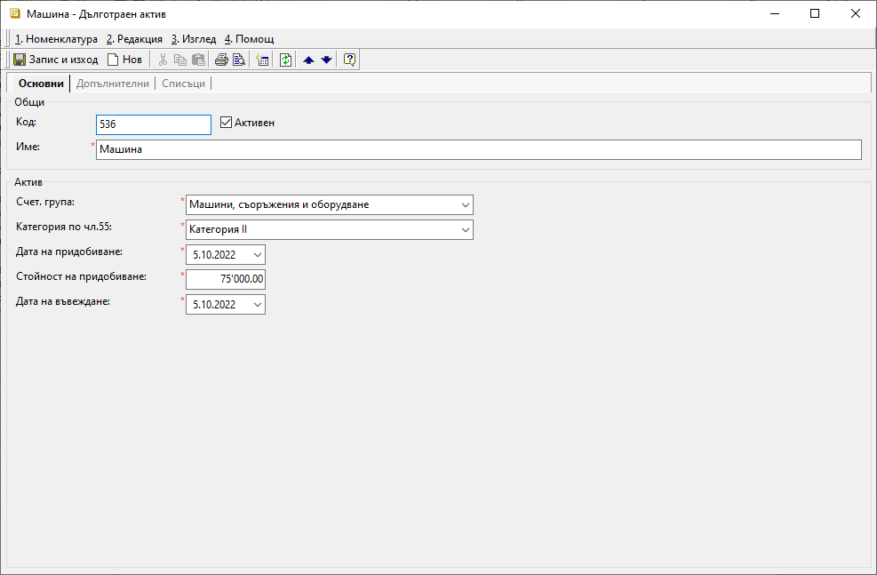
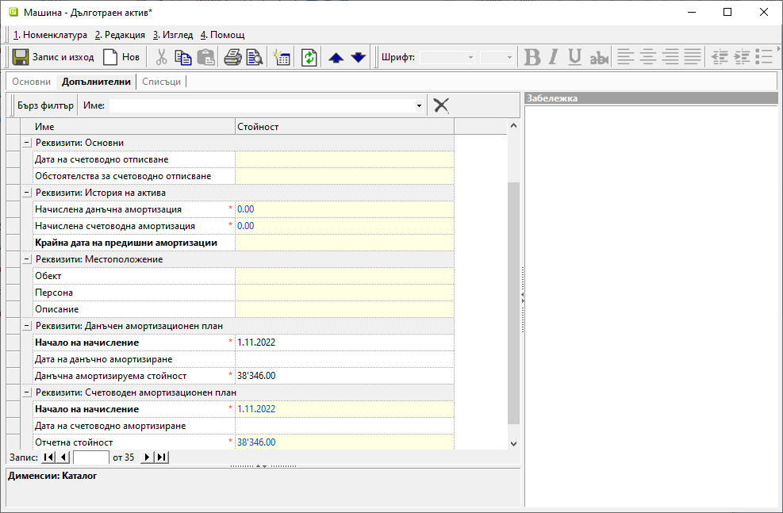
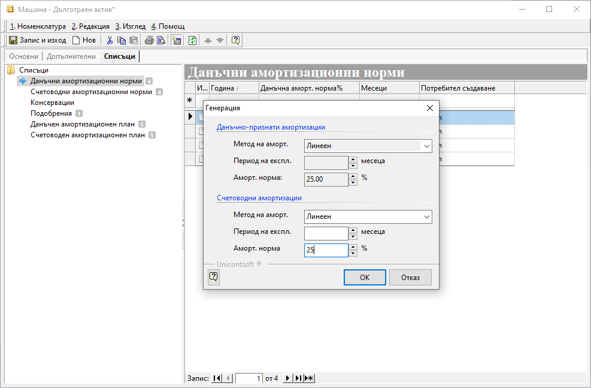

```{only} html
[Нагоре](000-index)
```

# **Дълготрайни активи**

- [Въведение](#въведение)   
- [Създаване на нов ДА](#добавяне-на-да)  
- [Реквизити](#реквизити)  
- [Свързани статии](#свързани-статии)

## **Въведение**  

Системата поддържа функционалност, която позволява ефективното управление на дълготрайните активи на организацията. Чрез **Номенклатури » Дълготрайни активи** всички ДА могат да бъдат регистрирани в системата. За всеки от тях се генерират данъчен и счетоводен амортизационен план.  

> Чрез инструмент за генерация амортизациите на ДА могат да бъдат осчетоводявани автоматично.  

За въвеждането на активите трябва предварително да бъдат настроени групите ДА, с които ще се работи. Това може да бъде направено в **Номенклатури » Референтни номенклатури » Дълготрайни активи: Групи ДА**.  

## **Добавяне на ДА**

1. **Създаване** 

В меню **Номенклатури » Дълготрайни активи** с десен клик се избира **Нов ДА**. Отваря се форма за въвеждане на нов актив.  
Задължителните реквизити са маркирани с червен символ.   

2. **Попълване на реквизити** 

В раздел **Основни** се попълват реквизити:  

- **Код** - По желание в полето се попълва код на ДА.  
- **Име** – В полето се въвежда избраното наименование на ДА.  
- **Счет. група** - От падащия списък се избира счетоводната група, към която се отнася ДА.
- **Категория по чл. 55** - В полето се избира категорията по чл. 55, в която попада ДА.   
- **Дата на придобиване** – Въвежда се датата на придобиване на актива, която обикновено съвпада с дата на фактурата за покупка.  
- **Стойност на придобиване** – В полето се посочва стойност на придобиване на ДА.  
- **Дата на въвеждане** - Попълва се дата на въвеждане на ДА в експлоатация. На база тази дата се определя от кой месец да започне начислението на счетоводните амортизации.  

> При промяна на **Дата на въвеждане** във вече записан актив системата иска потвърждение, ако предложената дата се различава от началото на начисление в някой от амортизационните планове.  

{ class=align-center w=15cm }

Полетата от раздел **Допълнителни**, включващи дата и обстоятелства на счетоводно отписване, се попълват единствено при продажба на ДА, бракуване или друго подобно действие.  
 
История на актива се въвежда, ако завеждате активи, които са закупени преди време и амортизацията им трябва да се продължи. Такива са например активите, които се прехвърлят от предишни програми.  
По подразбиране системата обзавежда с нулеви стойности начислените данъчна и счетоводна амортизация.   

Полетата за местоположение на ДА (**Обект**, **Персона** и **Описание**) не са задължителни. Използват се за отбелязване на детайли относно физическото местоположение на актива.  

{ class=align-center w=15cm }

В секция **Данъчен амортизационен план** полетата **Дата на данъчно амортизиране** и **Дата на счетоводно амортизиране** са винаги заключени. При включена настройка **Равнение на счетоводен и данъчен амортизационен план** се заключват и данъчните **Начало на начисление** и **Данъчна амортизируема стойност**, както и счетоводната **Остатъчна стойност (неамортизируема)**.   
Могат да бъдат попълнени реквизитите в секция **Счетоводен амортизационен план**. Такива са:  
- **Начало на начисление** - В полето се въвежда от кой месец да започне начислението на счетоводните амортизации.   
При нов актив системата попълва полето и за двата плана с първия ден на месеца след **Дата на въвеждане**.  
- **Отчетна стойност** - В общия случай това е стойността на придобиване на ДА. При нов актив полето се попълва автоматично със **Стойност на придобиване**.     
- **Остатъчна стойност (неамортизируема)** - Информацията се използва в счетоводния амортизационен план. При нов актив се попълва с 0 (нула) и може да се редактира при изключено равнение.   

> Разликата между **Отчетна стойност** и **Остатъчна стойност (неамортизируема)** формира счетоводната амортизируема стойност.  

От раздел **Списъци** могат да бъдат настроени данъчни и счетоводни амортизационни норми. Редовете могат да се въвеждат ръчно като стъпка за изчисляване на амортизационните планове. Записът на ДА допуска и празни списъци.    

За автоматично попълване на редовете при линеен метод се използва **Генериране**. Бутонът е достъпен от лентата с инструменти. Той отваря форма за попълване на реквизитите:   
   - **Метод на аморт.** – избира се метод, по който се амортизира ДА;  
   - **Период на експл.** – указва предполагаемият срок за практическо използване на актива (в месеци);  
   - **Аморт. норма** – годишна амортизационна норма в проценти;    

{ class=align-center w=15cm }

> Автоматичното им генериране по Период на експл. или Аморт. норма е реализирано за линейния метод. При него се попълва едно от двете полета, като нормата се задава в проценти.  
    
За потвърждаване на избора се използва бутон [**OK**]. Попълват се редовете с амортизационни норми. Амортизационните планове се изчисляват при **Запис** (**Запис и изход**).  
В раздел Списъци се виждат автоматично изчислените от системата **Данъчен амортизационен план** и **Счетоводен амортизационен план**.   
При редактиране и запис на настройките за метод и период/норма системата актуализира амортизационните планове спрямо направените промени.  

Секция **Консервации** се използва при временно преустановено използване на ДА, а секцията **Подобрения** - при направени подобрения на актива.  

3. **Запис**  

Чрез бутон [**Запис и изход**] в лентата с инструменти настройките се запаметяват и формата за редакция се затваря. С това активът е добавен в списъка.  

Номенклатурата може да бъде записана и без изход от формата. Използва се **Номенклатура » Запис** от основното меню или клавишна комбинация **Ctrl+S**.  

## **Реквизити**

1) В раздел **Основни**:  
   - **Код** – в полето се попълва код в цифри, букви и/или други знаци;  
   Системата автоматично обзавежда полето с пореден номер, ако бъде оставено празно.  
   - **Активен** - чрез поставяне/махане на отметка ДА се маркира като активна или неактивна номенклатура;  
   - **Име** – попълва се желаното наименование (задължителен реквизит);  
   - **Счет. група** - падащ списък за избор на счетоводна група на ДА;  
   Счетоводните групи трябва да са предварително въведени в **Номенклатури » Референтни номенклатури**.  
   - **Категория по чл. 55** - падащ списък за избор на категория на ДА;    
   Категориите по чл. 55 са предварително въведени в **Номенклатури » Референтни номенклатури**.  
   - **Датата на придобиване** – поле с дата на придобиване на ДА;   
   - **Стойност на придобиване** – поле със стойност на придобиване на ДА;  
   - **Дата на въвеждане** - попълва се дата на въвеждане на ДА в експлоатация;  

2) В раздел **Допълнителни**:  
   **Реквизити: Дименсии**  
   - **Група** - В тази секция се визуализират отделни полета за всички предварително дефинирани потребителски дименсии за продукти. Настройват се по желание, като се избират всички дименсии (категории), към които принадлежи ДА.  
   Използват се за групиране на списък с ДА (продукти).  
   Реквизитите с дименсии са променливи, като зависят от индивидуалните настройки в базата. Достъпни за настройка са предварително настроените списъци с дименсии за продукти, създадени от **Номенклатури » Потребителски дименсии**.  

   **Реквизити: Основни**  
   - **Дата на счетоводно отписване** – полето се попълва с дата, на която активът е отписан поради продажба, бракуване или друго;  
   - **Обстоятелства за счетоводно отписване** – в полето се попълват обстоятелства за счетоводно отписване, които ще се отпечатат в амортизационен план.  

   **Реквизити: История на актива**  
   - **Начислена данъчна амортизация** - попълва се, когато има начислени данъчни амортизации преди активът да е въведен в системата. Използва се при изчисляване на амортизационен план.  
   - **Начислена счетоводна амортизация** – използва се при изчисляване на амортизационен план, когато активът има начислени счетоводни амортизации преди завеждането му в системата;  
   - **Крайна дата на предишни амортизации** - попълва се крайната дата на начислените амортизации (последният календарен ден на месеца);  
   Използва се при изчисляване на амортизационен план.  
   Ако полето остане празно или датата е по-малка от **Начало на начисление**, стойностите се интерпретират като начална амортизация.  

   **Реквизити: Местоположение**  
   - **Обект** - падащ списък за избор на обект от настроените за **Потребител на продукта**;  
   Указва обект, в който се води ДА.  
   - **Персона** - списък за избор на служител от настроените за **Потребител на продукта**;  
   Указва лицето, на което се води ДА.  
   - **Описание** - поле за въвеждане на свободен текст с пояснение;  
   Използва се за допълнителни подробности относно местоположението на актива.  

   **Реквизити: Данъчен амортизационен план** 
   - **Начало на начисление** - показва от кой месец да започне начислението на данъчните амортизации. Използва се при изчисляване на данъчен амортизационен план.  
   При нов актив системата попълва първия ден от месеца след **Дата на въвеждане**.    
   - **Дата на данъчно амортизиране** - изчислява се от системата и служи за попълване на съответната информация в амортизационните планове;  
   Полето е винаги заключено.  
   - **Данъчна амортизируема стойност** - информацията се използва при изчисляване на данъчен амортизационен план;  
   При нов актив полето се попълва автоматично със **Стойност на придобиване**.     
   
   **Реквизити: Счетоводен амортизационен план**  
   - **Начало на начисление** - определя от кой месец да започне начислението на счетоводните амортизации (първият ден от месеца, следващ месеца на въвеждане на актива);  
   При нов актив системата попълва първия ден от месеца след **Дата на въвеждане**.  
   - **Дата на счетоводно амортизиране** - полето се изчислява от системата и е заключено за редакция;  
   Използва се за справочна информация.   
   - **Отчетна стойност** - в общия случай това е стойността на придобиване на ДА;  
   Използва се при изчисляване на счетоводен амортизационен план.  
   - **Остатъчна стойност (неамортизируема)** - използва се при изчисляване на счетоводен амортизационен план;  
   При нов актив полето се попълва с 0 (нула) и може да се редактира при изключено равнение.  

3) В раздел **Списъци**:  
   **Списъци**  
   - **Данъчни амортизационни норми** и **Счетоводни амортизационни норми** - при въвеждането им чрез бутон **Генериране** в лентата с инструменти се активира форма с реквизити:  
        - *Метод на аморт.* - поле с падащ списък за избор от настроените методи на амортизация;  
        - *Период на експл.* - поле за въвеждане на период на експлоатация в месеци;  
        - *Амортизационна норма* - поле с настройка за амортизационна норма в %;    
   - **Консервации** - Период на консервация се настройва, като се въведат начална и крайна дата на извеждане от експлоатация. Формата допуска празна крайна дата. При изчисляване на плановете обаче се включват само консервации с крайна дата след началната.   
   В поле *Обстоятелства* може да бъде добавен коментар с обстоятелствата, налагащи консервацията.  
   - **Подобрения** - В поле *Стойност* се посочва сумата на извършените разходи за подобрения. В поле *Дата на извършване* се посочва датата на подобрението.  
   - **Данъчен амортизационен план** - Системата генерира данъчен амортизационен план за текущия ДА.  
   - **Счетоводен амортизационен план** - Системата генерира счетоводен амортизационен план за текущия ДА.  

## **Свързани статии**
 
[Дълготрайни активи](../../005-how-to/010-fixed-assets.md)