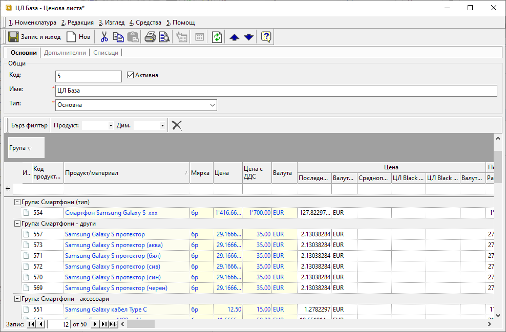
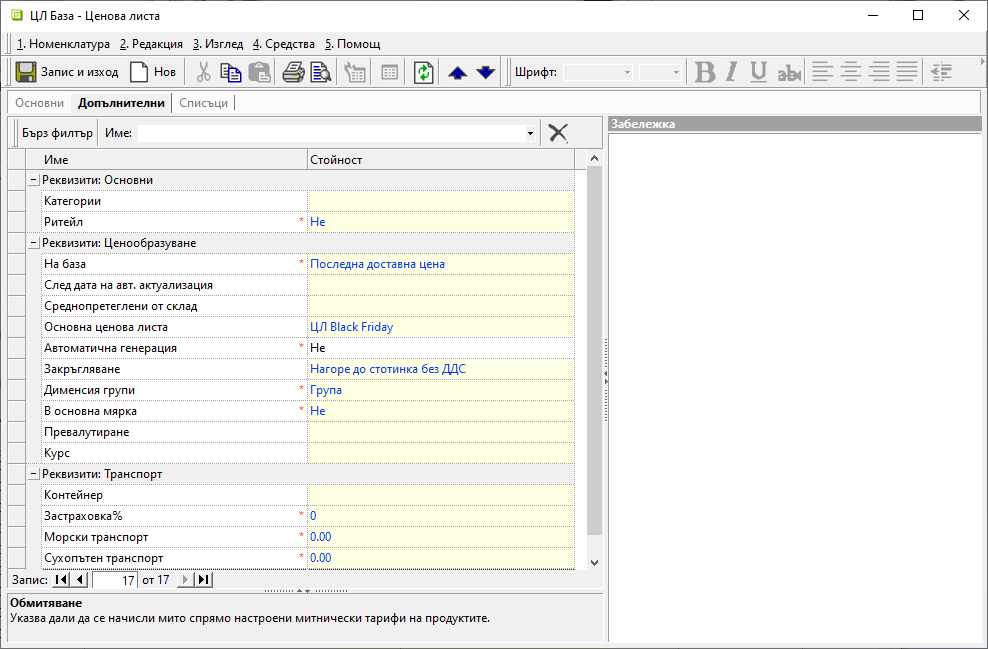
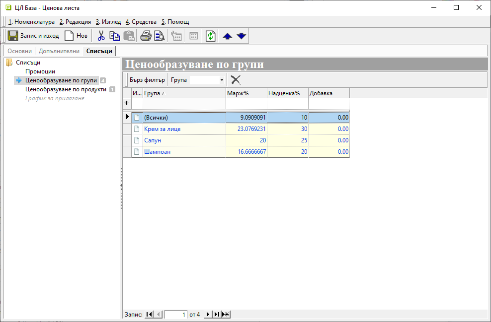

```{only} html
[Нагоре](000-index)
```

# **Ценови листи**

- [Въведение](#въведение)   
- [Създаване на нова ценова листа](#добавяне-на-ценова-листа)  
- [Реквизити](#реквизити)  
- [Свързани статии](#свързани-статии)

## **Въведение**  

Ценовите листи представляват шаблони с цени на продукти, които се прилагат в документи за покупка и продажба. Системата обзавежда автоматично цените за избраните продукти и изчислява стойностите в документа.  

> Такъв шаблон (ценова листа) може да бъде настроен към всеки контрагент.  
При продажба системата автоматично ще прилага индивидуалните цени.  

Системата позволява също настройка на валутни ценови листи. Стъпките в процеса на създаване на такава ЦЛ са същите. Единствената особеност е използването на различна валута със съответния ѝ курс.  

Ценовите листи в системата са разделени на два типа:    

- **Доставни ценови листи** - Попълват се от системата, когато автоматичното обновяване на ЦЛ е включено. Доставната цена се актуализира по доставчик от последната по дата приключена покупка.   

- **Клиентски ценови листи** - Трябва да бъдат настроени. Системата автоматично ще предлага цените при продажба след избор на контрагент.  

## **Добавяне на ценова листа**

1. **Създаване** 

В група функции **Номенклатури » Ценови листи** с десен клик върху списъка вдясно се избира **Нова ценова листа**. Отваря се празна форма за въвеждане на данни.  

2. **Попълване на реквизити** 

В раздел **Основни** се попълват задължителните реквизити с име и тип на ценовата листа.  
Типът на ценовата листа определя начина, по който системата я третира.  
   - **Основна** - Ценова листа, която се използва за водеща или за база при ценообразуване. Ценовите листи от този тип са без срок на валидност.  
   - **Корекция** - Допълнителна ценова листа с разлики в цените спрямо основната ЦЛ, към която се отнася. Влиза в сила от предварително заложена дата.  
   - **Промоция** - Ценова листа с временна валидност на цените, която се настройва към друга ЦЛ. Чрез полетата за начална и крайна дата се дефинира времевият обхват на прилагане на промоционалните цени.     
   - **Брошура** - Тип ценова листа, който отразява рекламна кампания, печатна брошура, промоционален каталог и подобни.  
   Настройва се в избраната ценова листа с определен период на валидност.  

От реда за нов запис се въвежда списък с продукти, които да участват в текущата ценова листа. Жълто оцветените полета се попълват със задължителния минимум от информация за настройка на ЦЛ:  
   - **Продукт/Материал** - В полетата от тази колона може ръчно да се въведат продукти и материали.  
   - **Мярка** - За всеки продукт се определя за каква мерна единица се отнася цената на реда.  

> В една ценова листа избран продукт може да участва повече от веднъж, но с различни мерни единици.  

   - **Цена**/**Цена с ДДС** - В полетата се попълват единични цени в избраната валута съответно без и с ДДС. След въвеждане на една от двете цени системата автоматично калкулира другата.  

   > Когато *ДДС вкл. в цената* е активно, сумата вече съдържа ДДС и системата я използва директно като *Цена с ДДС*. В останалите случаи двете полета се преизчисляват според ставката на продукта.  

   - **Валута** - Избор на валута, за която се отнасят текущите цени. Списъкът с валути трябва да бъде предварително настроен в системата.  

   { class=align-center w=15cm }

В раздел **Допълнителни** са включени реквизити, свързани с автоматичното ценообразуване, както и специфични настройки при транспорт - обмитяване, застраховка и др.  
Задължителните настройки са маркирани с червен символ. Системата е обзавела тези полета със стойности по подразбиране.    
   - **Ритейл** - задължителна настройка, която указва кои цени са водещи при формиране на тотали в продажба;  
   При *Ритейл: Да* цените с ДДС са водещи при изчисляване на общите суми в документите за продажба. С *Ритейл: Не* водещи са цените без ДДС.  
   - **На база** – избор на метод на ценообразуване, спрямо който впоследствие се изисква настройка на различни реквизити;
   - **След дата на авт. актуализация** - полето се настройва при база *Последни доставни цени*, като задава начална дата за филтър на покупки, от които се актуализира последна доставна цена.  
   - **Среднопретеглени от склад** - настройка при база *Среднопретеглени цени*, с която се указва склад, от който се взимат среднопретеглените цени.
   - **Основна ценова листа** - Полето се попълва при база *Основна ценова листа*, като се избира родителска ценова листа, от която се взимат базовите цени.  
   - **Автоматична генерация** - опция, която се активира, когато в списъка в раздел Основни няма записи;  
   Разрешава или забранява автоматичната генерация на цени при модификация на родителска ценовата листа, приключване на складови документи или приключване на покупка.  
   - **Закръгляване** - поле за избор на начин на закръгляване на цени от предварително въведените в **Референтни номенклатури » Закръглявания на цени**;  
   Използва се при ръчно или автоматично ценообразуване.  
   - **Дименсия групи** - поле за избор на дименсия, по която да се настройва *Ценообразуване по групи* в раздел **Списъци**;  
   - **В основна мярка** - указва дали да генерира цени в основна мярка при ценообразуване;  
   - **Превалутиране** - разрешава или забранява конвертиране на валутни цени (от покупки) в национална валута при ценообразуване;  
   - **Курс** - указва валутен курс за преизчисляване на цените;  

{ class=align-center w=15cm }

В раздел **Списъци** могат да бъдат настроени **Промоции**. Това са отделни ценови листи, които се прилагат с ограничена валидност.   
Промоционалните ЦЛ трябва предварително да са въведени като самостоятелни ценови листи. 

От **Списъци** са достъпни също настройки за ценообразуване по групи и по продукти, които се прилагат при генериране на нови цени. Те включват дефиниране на отделни *Марж %*, *Надценка* и/или *Добавка*.  
   - **Ценообразуване по групи** - Дефинира се списък с групи, за които могат да се настроят различни марж, надценка и/или добавка.   
   - **Ценообразуване по продукти** - Може да се въведе списък с продукти, за които ще има различни марж, надценка и/или добавка от настроените за групите, в които попадат.  

{ class=align-center w=15cm }  

> Ако за един продукт са дефинирани **Марж**, **Надценка** и/или **Добавка**, различни за него и групата, към която принадлежи, с по-голяма тежест винаги е настройката по продукт.  

3. **Запис**  

Чрез бутон [**Запис и изход**] в лентата с инструменти настройките се запаметяват и формата за редакция се затваря. С това ценовата листа е добавена в списъка.  

Номенклатурата може да бъде записана и без изход от формата. Използва се **Номенклатура » Запис** от основното меню или клавишна комбинация **Ctrl+S**.  

## **Реквизити**

1) В раздел **Основни**:  
   - **Код** – в полето може да се попълни код в цифри, букви и/или други знаци;  
   Системата автоматично обзавежда полето с пореден номер, ако бъде оставено празно.  
   - **Активна** - чрез поставяне/махане на отметка ценовата листа се маркира като активна или неактивна номенклатура;  
   - **Име** – в свободен текст се изписва наименование на ценовата листа;  
   - **Тип** - падащ списък за избор на тип на ценовата листа;  
   Списъкът е системно настроен и не подлежи на корекция от потребителите.  

   От реда за нов запис се обзавежда списък с продукти, участващи в ценовата листа. Колоните, които съдържа, са:  
   - **Икона** - полето съдържа символ, който се променя според вида на настройката (състоянието на реда);  
   - **Код продукт/материал** - полето се обзавежда с настроения основен код за избрания продукт;  
   - **Баркод продукт/материал** - полето се обзавежда с баркод за продукта в избраната мярка;  
   - **Вендор код на продукт/материал** - полето се обзавежда при наличие на настройка с външен код на избрания продукт, предоставен от доставчик;  
   - **Вендор име на продукт/материал** - полето се обзавежда при наличие на настройка с име на избрания продукт, предоставено от доставчик;  
   - **Продукт/материал** - поле за избор от списък с продукти и материали;    
   - **Мярка** - поле за избор на мерна единица;  
   - **Цена** - поле за единична цена без ДДС в избраната валута по ЦЛ;  
   - **Цена с ДДС** - поле за единична цена с ДДС в избраната валута по ЦЛ;    
   - **Валута** - от полето се отваря падащ списък за избор на валута;  
   - **Курс** - поле с валутен курс за избраната валута;  
   - **ДДС вкл. в цената** - указва включване на ДДС в цената на продукта от реда;  
   - **Забележка** - полето позволява въвеждане на свободен текст с уточнение за продукта на ред;  
   - **Група** - показва група, към която е настроен продуктът на реда;  
   - **Цена: Последна доставна** - показва цена на продукта на реда, с която е реализирана последната доставка;  
   - **Цена: Валута последна доставна** - показва валутата, в която е последната доставка на продукта на реда;  
   - **Цена: Среднопретеглена** - показва среднопретеглена цена при избран реквизит **Среднопретеглени от склад** в раздел **Допълнителни**;  
   - **Цена: Осн. доставна цена** - показва цена от избраната за основна ценова листа, когато в раздел **Допълнителни** е указана **Основна ценова листа**;  
   - **Цена: Осн. доставна цена с ДДС** - показва цена с ДДС от избраната за основна ценова листа, когато в раздел **Допълнителни** е указана **Основна ценова листа**;  
   - **Цена: Валута Осн. доставна цена** - показва валутата на основната доставна цена;  
   - **Последна доставна цена: Разлика** - показва текущата цена минус цената от избраната база, преизчислена във валутата на реда;  
   - **Последна доставна цена: Разлика %** - показва текущата минус базовата цена, в процент от базовата цена;  
   - **Ценообразуване: Марж %** - показва марж в %, настроен в ценовата листа за продукта на реда;  
   - **Ценообразуване: Надценка %** - показва % на надценката, настроена в ценовата листа за продукта на реда;  
   - **Ценообразуване: Добавка** - показва стойност на добавката, настроена в ценовата листа за продукта на реда;  
   - **Ценообразуване: Цена** - показва цена след добавяне на % надценка и **Добавка** към базовата цена за ценообразуване;  
   - **Ценообразуване: Цена с ДДС** - показва цена с ДДС след добавяне на % надценка и **Добавка** към базовата цена за ценообразуване;  
      > **Ценообразуване: Цена и Цена с ДДС** отчитат настроените транспортни разходи, застраховка, мито и закръгляване.  
   - **Ценообразуване: Разлика** - показва текущата минус предложената цена;  
   - **Ценообразуване: Разлика %** - показва текущата минус предложената цена, в процент от предложената цена;  
   - **Ценообразуване: Базова разлика** - показва предложената минус базовата цена;   
   - **Ценообразуване: Базова разлика %** - показва предложената минус базовата цена, в процент от базовата цена;  
   - **ДДС ставка на продукт/материал** - показва % на ДДС ставката, настроена за продукта на реда;  
   - **Прецизност цена с ДДС** - показва стойностите от настройките на продукта в раздел **Допълнителни » Прецизност крайна цена с ДДС**;  
   - **Мито ставка на продукт/материал** - показва дефиниран % митническа тарифа, избрана за продукта на реда в раздел **Допълнителни » Митническа тарифа**;  
   - **Потребител създаване** - информация за потребител, добавил текущия ред;  
   - **Дата създаване** - дата и час на добавяне на текущия ред;  
   - **Потребител последна модификация** - потребителско име на направилия последните корекции в данните на реда;  
   - **Дата последна модификация** - информация за дата и час, когато са направени последните изменения в данните на текущия ред;  

   > Като отделни колони се визуализират текущо настроените фасети и дименсии за Продукти и дълготрайни активи.  

2) В раздел **Допълнителни**  
   **Реквизити: Основни**  
   - **Категории** - използва се за ограничаване на достъп до ценови листи по категории;  
   - **Ритейл** - в полето с *Да/Не* се указва дали цени с ДДС са водещи при формиране на тотали в документите за продажба;  

   **Реквизити: Ценообразуване**  
   - **На база** – избор на метод за ценообразуване;  
   Указва начин на ръчно или автоматично ценообразуване.  
   - **След дата на авт. актуализация** - полето се настройва при база *Последни доставни цени* с начална дата за филтър на покупки, от които да се актуализира последна доставна цена;  
   Ако не е указана дата, се взимат всички доставни цени.  
   - **Среднопретеглени от склад** - избор на склад, от който се взимат среднопретеглени цени;  
   Настройката се прилага при избрана база *Среднопретеглени цени*.  
   - **Основна ценова листа** - поле за избор на родителска ценова листа, от която се взимат базовите цени;  
   Попълва се при избрана база *Основна ценова листа*.   
   - **Автоматична генерация** - с *Да/Не* се разрешава/забранява автоматична генерация на цени при модификация на родителската ценова листа, приключване на покупки или складови документи;
   Опцията се активира, когато в списъка от раздел *Основни* няма записи.   
   - **Закръгляване** - падащ списък за избор на начин за закръгляване на цени при ръчно или автоматично ценообразуване;  
   Списъкът се дефинира предварително от **Референтни номенклатури » Закръглявания на цени**.  
   - **Дименсия групи** - поле за избор от списък с дименсии;  
   Указва дименсия, по която се настройва *Ценообразуване по групи* в раздел *Списъци*.   
   - **В основна мярка** - с *Да/Не* се указва дали при ценообразуване да се генерират цени в основна мярка;  
   - **Превалутиране** - с *Да/Не* се указва дали да се генерират цени в избраната валута при ценообразуване.  
   - **Курс** - попълва се курс при генериране на цени във валута;  

   **Реквизити: Транспорт**  
   - **Контейнер** - падащ списък за избор на мярка на контейнер;  
   За избраната мярка трябва да има настроени фасети на продуктите, за които ще се разпределят транспортни разходи.  
   - **Застраховка%** - в полето се попълва процент застраховка спрямо FOB цена;  
   - **Морски транспорт** - поле с цена на морски транспорт (ocean freight) за контейнер;  
   - **Сухопътен транспорт** - поле с цена на сухопътен транспорт (land transport) за контейнер;  
   - **Обмитяване** - с *Да/Не* указва дали да се начисли мито спрямо настроени митнически тарифи на продуктите;  

3) В раздел **Списъци**:  
   **Списъци**  
   - **Промоции** - Добавяне на готови ценови листи с намаления и ограничена валидност;    
   - **Ценообразуване по групи** - От списъка вдясно се избират групи с отстъпка, като се обзавеждат колони:   
        - *Група* - избор на дименсия;  
        Отстъпката може да се настрои общо за всички или за отделни групи продукти.  
        - *Марж %* - попълва се стойност на желания процент марж;  
        - *Надценка* - попълва се стойност на желаната надценка;  
        - *Добавка* - опция с точна сума, която да се добави в цената;  
   - **Ценообразуване по продукти** - От списъка се посочват продукти, за които ще има индивидуални надценки и/или добавки, като се обзавеждат колони:   
        - *Продукт/материал* - поле за избор на продукт;  
        Отстъпката може да се настрои общо за всички или за отделни продукти.  
        - *Мярка* - посочва се мерната единица, която се отнася за реда;  
        Когато се правят настройки за повече от една мерна единица, трябва всяка една да е на отделен ред.   
        - *Марж %* - поле с марж в проценти;  
        Може да се изчисли автоматично от системата след настройка на полето с надценка;  
        - *Надценка* - попълва се стойност на желаната надценка в проценти;  
        - *Добавка* - опция с точна сума, която да се добави в цената;  
   - **График за прилагане** - Тази секция с настройки се активира за ценови листи от тип *Корекция*.  
   От списъка вдясно се указва от коя дата и към коя ценова листа се активират текущите корекции на цените.   
        - *На дата* - указва начална дата за изпълнение, от която се прилагат текущите корекции на цени;  
        - *Ценова листа* - от падащ списък се избира ценова листа, за която се отнасят текущите корекции на цени;  
        - *Активен* - отметката указва изпълнение по график;  
        За ръчно изпълнение се маркират редовете от графика и с десен клик се избира **Незабавно прилагане на график**.  

## **Свързани статии**
 
[Ценови листи и схеми с търговски отстъпки](../../../../start/006-price-lists-and-discount-schemes.md)