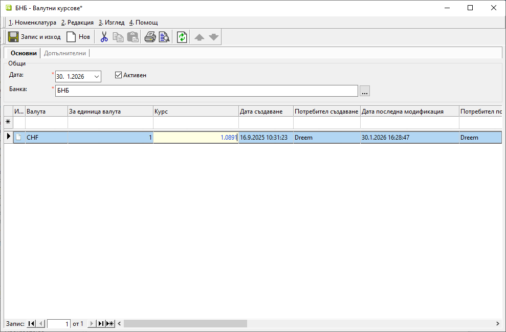

```{only} html
[Нагоре](000-index)
```

# **Валутни курсове**

- [Въведение](#въведение)  
- [Добавяне на нов валутен курс](#добавяне-на-валутен-курс)  
- [Реквизити](#реквизити)  
- [Свързани статии](#свързани-статии)  

## **Въведение**

Номенклатура **Валутни курсове** се използва при въвеждането на документи в системата. На база въведени валутни курсове системата автоматично пресмята стойности в местна валута за валутните документи.  

За да се използват валутните курсове, е необходимо да се реализират следните операции:  

- Дефиниране на *Контрагент Търговска банка* за потребителя на продукта;  
- Въвеждане на валутните курсове за датите, за които трябва да се използва нов курс;  

> При липса на активен курс за избраната дата се използва фиксираният курс на валутата. Ако такъв не е настроен, се взема последният активен курс на банката преди тази дата.  

## **Добавяне на валутен курс**

1. **Създаване** 

За добавяне на нов запис се отваря група функции **Номенклатури » Валутни курсове**.  
Чрез десен клик върху списъка се избира **Нов валутен курс**. Отваря се формата за въвеждане на реквизити:  

{ class=align-center w=15cm }

2. **Попълване на реквизити** 

В раздел **Основни** по подразбиране е попълнена текуща дата. Реквизитът **Дата** може да бъде редактиран.   

Чрез поставяне или премахване на отметка в **Активен** номенклатурата се активира или деактивира.  

От поле **Банка** се отваря списък **Счетоводни признаци** за избор на банката, чиито курсове се въвеждат.      

На реда за нов запис се попълва **Валута**. В рамките на списъка всяка валута се въвежда само веднъж.  
В поле **За единица валута** се указва броят единици от избраната валута и в **Курс** се въвежда равностойността им в местна валута.    

> Системата не допуска повторение на валута в активните записи за същите дата и банка.  

3. **Запис**  

Чрез бутон [**Запис и изход**] в лентата с инструменти настройките се запаметяват и формата за редакция се затваря. С това валутният курс е добавен в списъка.  

Номенклатурата може да бъде записана и без изход от формата. Използва се **Номенклатура » Запис** от основното меню или клавишна комбинация **Ctrl+S**.  

## **Реквизити**

1) В раздел **Основни**:  
   - **Дата** - указва дата, за която се отнасят валутните курсове в текущия запис;   
   Реквизитът е задължителен.  
   - **Активен** - чрез поставяне/махане на отметка валутният курс се маркира като активна или неактивна номенклатура;  
   - **Банка** – отваря форма за избор на банка от списък **Счетоводни признаци**;  
   Реквизитът е задължителен.  
   При автоматично търсене на валутен курс се използва по подразбиране настройката от **Администрация » Настройки** в реквизит **Контрагент Търговска банка**.  

   От реда за нов запис се обзавежда списък с валути. Колоните, които съдържа, са:  
   - **Икона** - полето съдържа изображение със символ, който варира според вида на настройката (състоянието на реда);  
   - **No.** - пореден номер на запис по реда на въвеждане;  
   - **Валута** - отваря падащ списък за избор на валута;  
   Списъкът трябва да бъде настроен предварително от **Номенклатури » Референтни номенклатури**.  
   - **За единица валута** - попълва се броят единици от избраната валута, за които се отнася курсът на реда. По подразбиране се попълва 1;  
   - **Курс** - валутен курс за валута на реда от избраната банка;  
   - **Потребител създаване** - информация за потребител, добавил текущия ред;  
   - **Дата създаване** - дата и час на добавяне на текущия ред;  
   - **Потребител последна модификация** - потребителско име на направилия последните корекции в данните на реда;  
   - **Дата последна модификация** - информация за дата и час, когато са направени последните изменения в данните на текущия ред;  

2) В раздел **Допълнителни**:  
- **Забележка** - поле за свободен текст с уточнения;   

## **Свързани статии**

[Референтни номенклатури](001-ref-nomenclatures.md)  