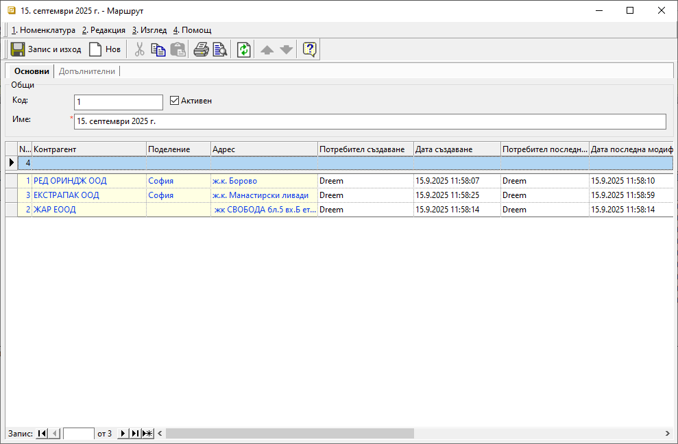
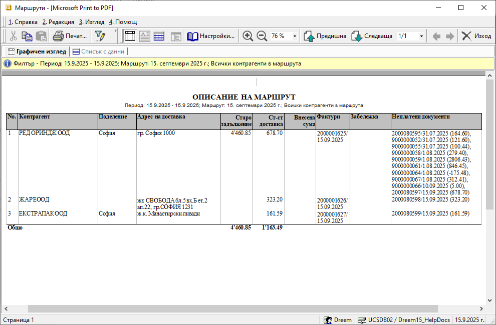

```{only} html
[Нагоре](000-index)
```

# **Маршрути**

- [Въведение](#въведение)
- [Създаване на нов маршрут](#добавяне-на-маршрут)   
- [Реквизити](#реквизити)
- [Свързани статии](#свързани-статии)  

## **Въведение**

Чрез номенклатура **Маршрути** контрагенти и обекти се включват в маршрутен лист по определени критерии - дата на доставка, общ маршрут при доставка и т.н.  
При разпечатване на маршрутния лист са включени задълженията на участниците - стари и настоящи (от текущата доставка).  

> При извеждане на маршрутния лист се избира периодът, за който да се покажат документите.  

Данните са групирани по контрагенти и обекти.  
Служителят, изпълняващ маршрута, може да попълни данни за получените суми и забележки към участващите документи.  

## **Добавяне на маршрут**  

1. **Създаване** 

В група функции **Номенклатури » Маршрути** с десен клик върху списъка със записи се избира **Нов маршрут**. Системата отваря празна форма за въвеждане на данни.  

{ class=align-center w=15cm }

2. **Попълване на реквизити** 

Поле **Код** се попълва по желание. Задължително за попълване е полето **Име** с избрано наименование за маршрута.  
Системата автоматично е маркирала текущия маршрут с **Активен**.  

От реда за добавяне на нов запис се въвежда списък с всички контрагенти, включени в маршрута. За целта се използва поле **Контрагент**.  
Когато доставките се извършват по обекти, се обзавежда и поле **Обект**.  
Поле **Адрес** се попълва автоматично от избрания обект. Ако няма избран обект, се използва адрес на контрагента.  
Попълненият адрес може да се редактира.  

> В маршрутния лист се показва адрес за доставка от документа, ако е посочен. Иначе показва адрес от маршрута.  

Въведените данни се записват без излизане от формата - чрез клавишна комбинация **Ctrl+S** или от меню **Номенклатура » Запис**.  

3. **Преглед и печат** 

Маршрутният лист се отваря за преглед и/или печат чрез съответния бутон от лентата с инструменти.  
Той показва неплатените остатъци по документи преди периода и стойностите с ДДС на приключените продажби с дата в избрания период.   
Различен период на справката се задава от формата за филтриране.  

{ class=align-center w=15cm }

4. **Запис**  

Чрез бутон [**Запис и изход**] в лентата с инструменти настройките се запаметяват и формата за редакция се затваря. С това маршрутът е добавен в списъка.  

Номенклатурата може да бъде записана и без изход от формата. Използва се **Номенклатура » Запис** от основното меню или клавишна комбинация **Ctrl+S**.  

## **Реквизити**

1) В раздел **Основни**:  
   - **Код** – в полето се попълва код в цифри, букви и/или други знаци;  
   Ако бъде оставено празно, системата автоматично обзавежда полето с пореден номер.  
   - **Активен** - чрез поставяне/махане на отметка маршрутът се маркира като активна или неактивна номенклатура;  
   - **Име** – попълва се наименование за маршрутния лист;  

   От реда за нов запис се обзавежда списък с контрагентите, участващи в маршрута. Колоните, които съдържа, са:  
   - **No.** - пореден номер на запис по реда на въвеждане;  
   - **Контрагент** – в полето се отваря форма за избор **Контрагенти**;  
   - **Обект** - поле за избор от списък с настроените за контрагента обекти;  
   - **Адрес** - указва адрес на доставка по маршрута;  
   Попълва се автоматично с адрес за доставка на обекта. Ако няма избран обект, се използва адрес за доставка на контрагента.  
   Ако адресите за доставка не са настроени, се използва съответният основен адрес.    
   - **Потребител създаване** - информация за потребител, добавил текущия ред в документа;  
   - **Дата създаване** - дата и час на добавяне на текущия ред;  
   - **Потребител последна модификация** - потребителско име на направилия последните корекции в данните на реда;  
   - **Дата последна модификация** - информация за дата и час, когато са направени последните изменения в данните на текущия ред;  

2) Раздел **Допълнителни**:  
   **Реквизити: Основни**  
   - **Шаблон за печат** - указва шаблон за текста, който се отпечатва след списъка;  
   При създаване на маршрут се зарежда шаблон по подразбиране, ако е настроен.  
   Текстовете на шаблони трябва да бъдат въведени предварително от **Номенклатури » Референтни номенклатури » Текстови шаблони**.  

## **Свързани статии**  

[Референтни номенклатури](001-ref-nomenclatures.md)  
[Контрагенти](002-contragents.md)  
[Създаване на документ за продажба](../../002-docs/001-trade-system/001-orders-sales-purchase-documents/003-create-sales-document.md)  