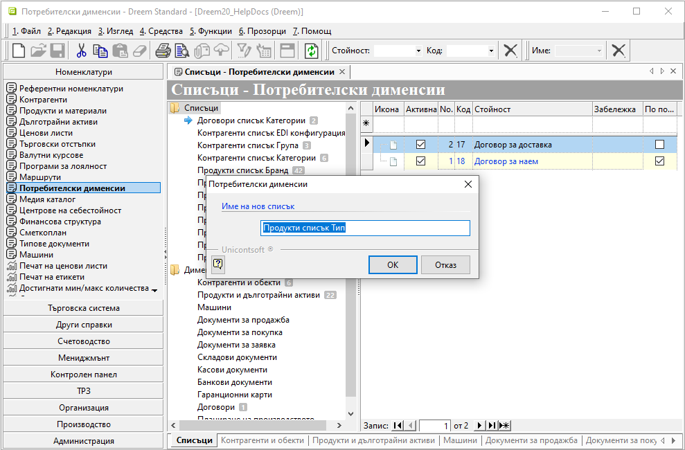
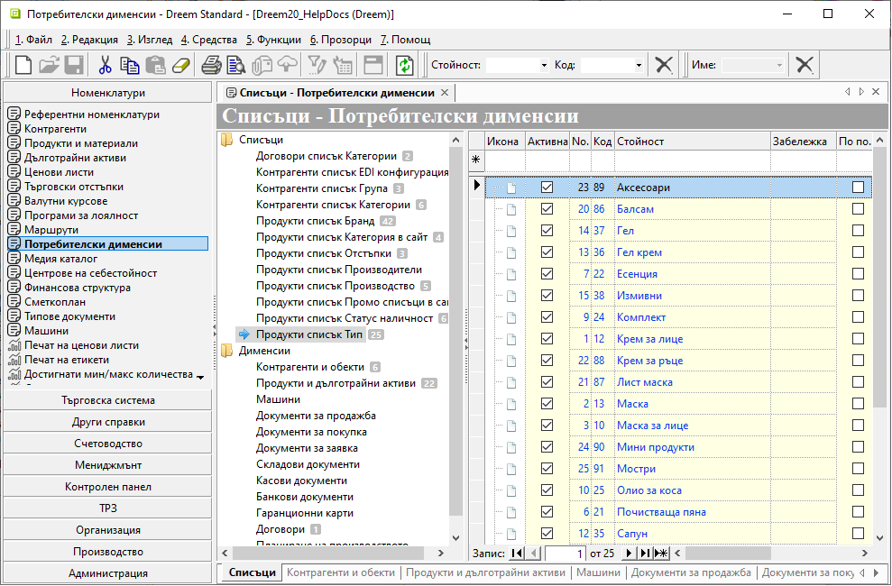
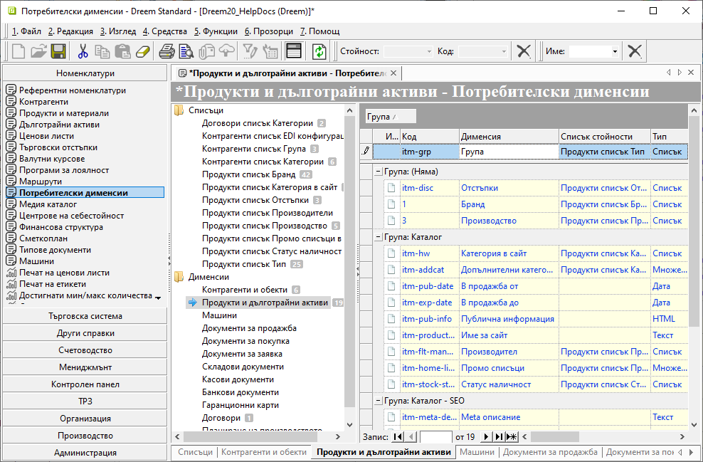

```{only} html
[Нагоре](000-index)
```

# **Потребителски дименсии**

- [Въведение](#въведение)
- [Настройка на Списъци](#настройка-на-списъци)  
- [Настройка на Дименсии](#настройка-на-дименсии)  
- [Реквизити](#реквизити)
- [Свързани статии](#свързани-статии)  

## **Въведение**

Дименсиите в системата служат за категоризиране на данни. Чрез тях се изграждат персонализирани категории за групиране на данните, които впоследствие могат да бъдат анализирани детайлно.  
Системата дава възможност за дефиниране на дименсии по продукти, контрагенти и различни документи - продажби, покупки, складови и други документи.   

Настройките на **Потребителски дименсии** се изграждат в две стъпки:  

- **Списъци**       
Списъците представляват каталози със стойности за избор на групи продукти, контрагенти, договори и пр. Списъците се създават за дименсиите от тип *Списък* или *Множество*.   

```{tip}
Препоръчително е при избор на име на списъците да се добави за коя номенклатура или тип документ се отнася. Това ще помогне за по-лесно и бързо ориентиране в целия набор от списъци.  
```

- **Дименсии**  
Настройката на *Дименсии* указва как системата да третира отделните категории. Това се определя чрез типа на дименсията.  
Системата дава възможност за избор от следните типове:  

    - Тип **Списък** - ограничава категоризирането само към една от стойностите на списъка;  
    - Тип **Текст** - въвеждане на обикновен текст;  
    - Тип **Число** - категоризиране с числови стойности;  
    - Тип **Дата** - възможност за категоризиране по дата;  
    - Тип **Час** - възможност за категоризиране по час;  
    - Тип **Да/Не** - категоризиране като отговарящи или неотговарящи на определен критерий;  
    - Тип **Множество** - допуска категоризирането към повече от една стойност на списъка;  
    - Тип **RTF** - въвеждане на форматиран текст;  
    - Тип **HTML** - редактиране на HTML съдържание;  
    - Тип **Медия** - настройка чрез избор на файл от **Медия каталог**;         

## **Настройка на Списъци**  

Нов списък се създава по следния начин:

1) От модул **Номенклатури » Потребителски дименсии** с десен клик върху група *Списъци* се избира *Нов списък*. Системата отваря прозорец с празно поле. Въвежда се наименование в свободен текст и с бутон [**OK**] се добавя като нова категория в *Списъци*. 

{ class=align-center w=15cm }

2) В колона *Стойност* на списъка се попълват наименования за всяка подкатегория. 

{ class=align-center w=15cm }

3) Промените се запаметяват с бутон [**Запис**] от лентата с инструменти. С това съдържанието на списъците е добавено.  

> За да бъдат видими и достъпни в настройките, **Списъци** трябва да бъдат разпределени към **Дименсии**.  

```{tip}
Във всеки един момент може да се редактират и добавят нови записи.  
Изтриването е възможно единствено, когато настройките все още не са използвани в системата. 
```

## **Настройка на Дименсии** 

За конфигуриране на нова настройка в секция **Дименсии** се маркира *Контрагенти и обекти*, *Продукти и дълготрайни активи*, *Машини* или тип документ.  
От списъка вдясно се попълват полетата на реда за добавяне на нов запис.  

- **Дименсия** -  Изписва се наименование на категорията. С това име дименсията се визуализира във филтрите и в списъците с продукти.  

{ class=align-center w=15cm }

- **Тип** - От падащия списък в тази колона се избира видът на дименсията.  
- **Списък стойности** - Отваря се падащ списък за избор от предварително въведените **Списъци**.  
Настройва се задължително за дименсиите от тип *Списък* и *Множество*.  
- **Задължителна** - Чрез отметка дименсията може да се настрои като задължителен реквизит. С това системата не позволява запис на нов или редакция на съществуващ продукт, без да се избере стойност за дименсията.     
- **Описание** - В полето може да се даде кратко описание, което да служи за добавяне на помощен текст или др.  

Всички направени промени трябва да бъдат записани, за да влязат в сила.  

## **Реквизити**

Списъците за настройка на дименсии включват следните колони с реквизити:  

   **Списъци**:  
   - **No** - пореден номер на реда в текущия списък;  
   - **Код** - указва номер на запис;  
   При празно поле системата генерира пореден номер.  
   - **Стойност** - в полето се въвежда наименованието на отделния запис в списъка;     
   - **Медия съдържание** - отваря форма за избор на прикачен файл от настроените папки в *Медия каталог*;  
   - **Изображение** - отваря форма за избор на изображение от настроените папки в *Медия каталог*;  
   - **Адрес на изображение** - попълва се автоматично при избор на изображение от Медия каталог и се изчиства при премахването му;  
   - **Забележка** - поле за попълване на свободен текст с уточняваща информация;  
   - **Активна** - чрез поставяне/махане на отметка записът се маркира като активна/неактивна номенклатура в списъци;  
   - **По подразбиране** - чрез поставяне на отметка текущият ред се маркира като опция, която системата да предлага по подразбиране;  
   Само един запис може да бъде настроен с *По подразбиране*.   
   - **Допълнителен код** - полето може да се обзаведе с допълнителен код чрез десен клик на реда и *Преведи*;  
   - **Допълнителна стойност** - полето може да се обзаведе с допълнително наименование чрез десен клик на реда и *Преведи*;  
   - **Потребител създаване** - информация за потребител, добавил текущия ред;  
   - **Дата създаване** - дата и час на добавяне на текущия ред;  
   - **Потребител последна модификация** - потребителско име на направилия последните корекции в данните на реда;  
   - **Дата последна модификация** - информация за дата и час, когато са направени последните изменения в данните на текущия ред;  

   **Дименсии**:  
   - **No** - пореден номер на реда със запис в текущия списък;  
   - **Група** - обединява дименсиите под общо заглавие във формата, в която се попълват;   
   - **Код** - код на записа или на дименсията;  
   При запис и празно поле се генерира пореден номер.    
   - **Дименсия** - в полето се въвежда наименование на текуща дименсия;  
   - **Описание** - поле за попълване на свободен текст с уточняваща информация;   
   - **Тип** - падащ списък за избор на тип за текуща дименсия;  
   - **Редакция** - указва типа на редакция на дименсия;  
   Тип *Автоматично* - системата отваря падащ списък със стойности при прилагане на текущата дименсия.  
   Тип *Форма за избор* - системата отваря форма за избор със стойности при прилагане на текущата дименсия.    
   - **Списък стойности** - поле за избор на регистър със записи, отнасящ се към текущата дименсия;  
   Това са настроените от *Списъци* каталози.  
   - **Активна** - чрез поставяне/махане на отметка записът се маркира като активна/неактивна номенклатура в списъци;  
   - **Задължителна** - чрез поставяне/махане на отметка текущата дименсия се определя като задължителна/незадължителна настройка;  
   - **Прецизност** - указва броя на десетичните знаци при редактиране на стойност от тип *Число*;  
   Полето може да остане празно.    
   - **Мярка** - мерна единица за дименсия от тип *Число*;    
   - **Стойност по подразбиране** - задава се стойност, която системата да попълва автоматично за нов продукт;  
   - **Допълнителен код** - полето може да се обзаведе с допълнителен код чрез десен клик на реда и *Преведи*;    
   - **Допълнително име** - полето може да се обзаведе с допълнително наименование чрез десен клик на реда и *Преведи*;  
   - **Потребител създаване** - информация за потребител, добавил текущия ред;  
   - **Дата създаване** - дата и час на добавяне на текущия ред;  
   - **Потребител последна модификация** - потребителско име на направилия последните корекции в данните на реда;  
   - **Дата последна модификация** - информация за дата и час, когато са направени последните изменения в данните на текущия ред;  

## **Свързани статии**  

[Използване на дименсиите в Продукти и материали](../../005-how-to/015-custom-dimensions.md)