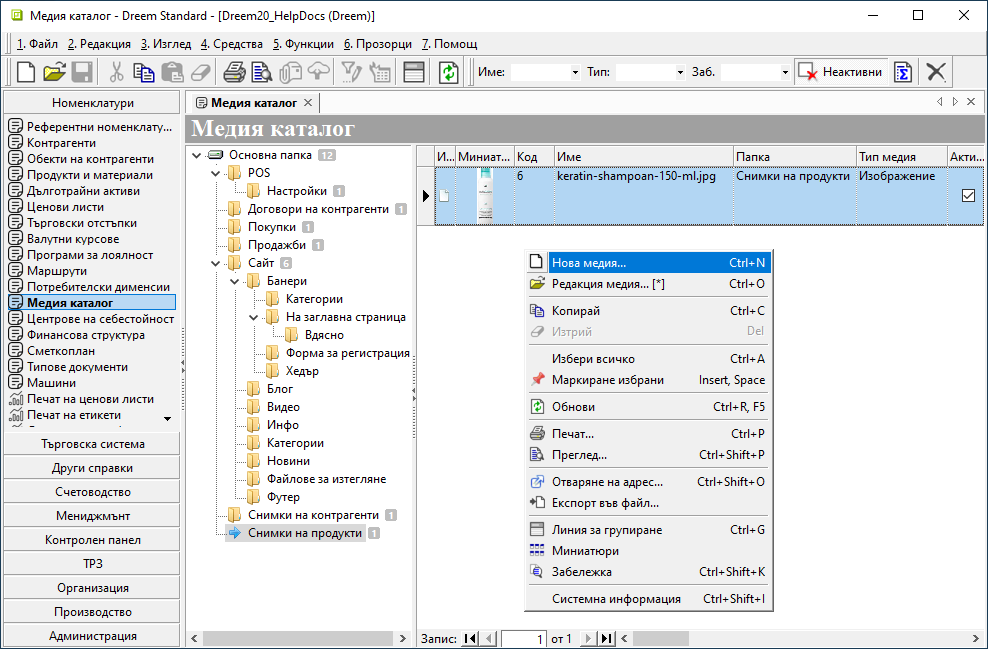
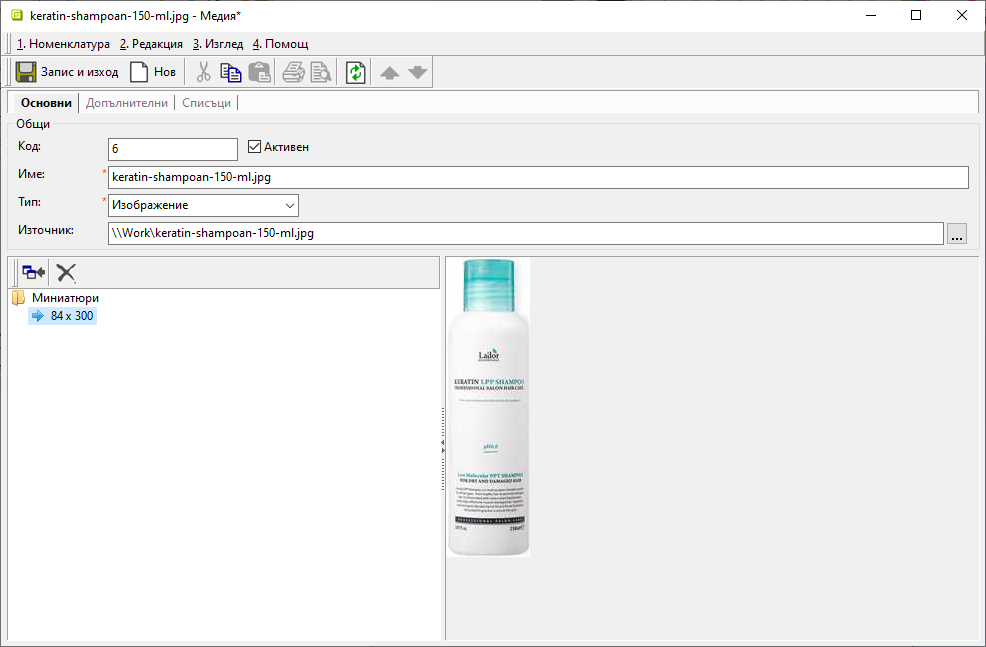

```{only} html
[Нагоре](000-index)
```

# **Медия каталог**

- [Въведение](#въведение)
- [Добавяне на настройка в Медия каталог](#нова-настройка-в-медия-каталог)   
- [Реквизити](#реквизити)
- [Свързани статии](#свързани-статии)  

## **Въведение**

**Медия каталог** служи за организиране на изображения, документи и HTML съдържание в папки.  
Чрез каталога за всяка медия се управляват източниците и се проследява дали има връзки към продукти или контрагенти.  

## **Нова настройка в Медия каталог**  

1. **Създаване**   

В меню **Номенклатури » Медия каталог** се маркира подпапка, към която се създава нова медия.  
С десен клик върху списъка се избира **Нова медия** (**Ctrl+N**). Отваря се празна форма за въвеждане на данни.  

> Системата изисква подпапка за създаване на медия.  
Нова подпапка може да бъде добавена с десен щрак върху избрана папка и **Нова папка…**.  

{ class=align-center w=15cm }

2. **Попълване на реквизити**

Съдържанието се добавя според избрания **Тип** на въвежданата настройка:  

- **Изображение**	или **Видео**  

В **Източник** се избира файл или се въвежда URL. При избор на локално изображение системата може да предложи импорт на миниатюра.  

- **Документ** или друг прикачен файл   

Попълват се реквизити **Име** и **Източник**. При избор на локален файл системата предлага да импортира съдържанието му.  

- **Конфигурация** (**HTML съдържание**)  

Попълват се **Име** и **Заглавие**. При указване на тип *Конфигурация* в долния ляв ъгъл на формата се активират **Редактор** и **Изходен код** за създаване на съдържанието.  

{ class=align-center w=15cm }

В раздел **Допълнителни** се задават атрибути като автор, тагове и дати на публикуване и прекратяване.  

3. **Запис**  

Чрез бутон [**Запис и изход**] в лентата с инструменти настройките се запаметяват и формата за редакция се затваря. С това новата настройка е добаявена в списъка.  

Номенклатурата може да бъде записана и без изход от формата. Използва се **Номенклатура » Запис** от основното меню или клавишна комбинация **Ctrl+S**.  

## **Реквизити**  

1) В раздел **Основни**:  

   - **Код** - в полето може да се попълва код с цифри, букви и/или други знаци;  
   Системата автоматично обзавежда полето с пореден номер, ако бъде оставено празно.  
   - **Активен** - чрез поставяне/махане на отметка контрагентът се настройва като активна/неактивна номенклатура;  
   - **Име** - избрано наименование на медията;  
   - **Тип** - отваря падащ списък за избор на вид медия;  
   Списъкът се зарежда от **Номенклатури » Референтни номенклатури » Типове медия**.   
   - **Източник** - указва път до оригиналното изображение или файл;  

2) В раздел **Допълнителни**:  
   
   **Реквизити Основни**  
   - **Папка** - указва папка на медия;  
   - **Източник** - указва папка или URL адрес на източник на изображение или документ;  
   - **Заглавие** - указва заглавие на HTML съдържание;  
   
   **Реквизити Съдържание**  
   - **Дата на публикуване** - указва дата на публикуване на съдържанието;  
   - **Дата на прекратяване** - указва дата на прекратяване на публикуване на съдържанието;   
   - **Автор** - указва автор на съдържанието;  
   - **Тагове** - указва тагове за търсене на съдържанието, разделени със запетая;  
   - **Оформление** - за свързаната категория на сайт указва оформление на детайли на продукти, за които тази категория е основна. За изображения указва позиция в контейнер. Свободен текст като book, kidstoys, paper и пр. или UpperLeft, UpperRight, LowerLeft, и LowerRight;  

   **Реквизити Връзка**  
   - **Адрес (URL)** - указва URL адрес на връзка за изображение или документ, към която да се навигира вместо показване на съдържанието;  
   - **Атрибути** - указва допълнителни атрибути на <*a*> таг на връзката;  
   
   **Реквизити Изображение**  
   - **Широчина** - указва желана широчина на изображението;  
   - **Височина** - указва желана височина на изображението;  
   - **Изходен тип** - указва изходен MIME тип на изображението;  
   - **Качество** - указва желано качество на изображението ако е от изходен тип image/jpeg;  

   **Реквизити Анотация**  
   - **Текст** - указва кратка анотация към статията;  
   - **Изображение** - указва изображение за анотация към статията;  

   **Реквизити Мета данни**  
   - **Описание** - указва мета описание на съдържанието;  
   - **Ключови думи** - указва мета ключови думи на съдържанието;  
   - **Slug** - указва slug на адрес за SEO. Ако е празно, автоматично се генерира от *Име на медия*;  

3) В раздел **Списъци**:  

В групи **Връзки от продукти** и **Връзки от контрагенти** са достъпни за преглед съответните свързани номенклатури, включващи тази медия.  

## **Свързани статии**  

[Контрагенти](002-contragents.md)  
[Продукти](004-items.md)