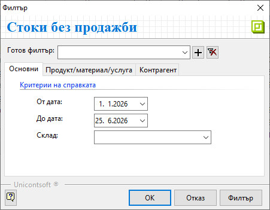
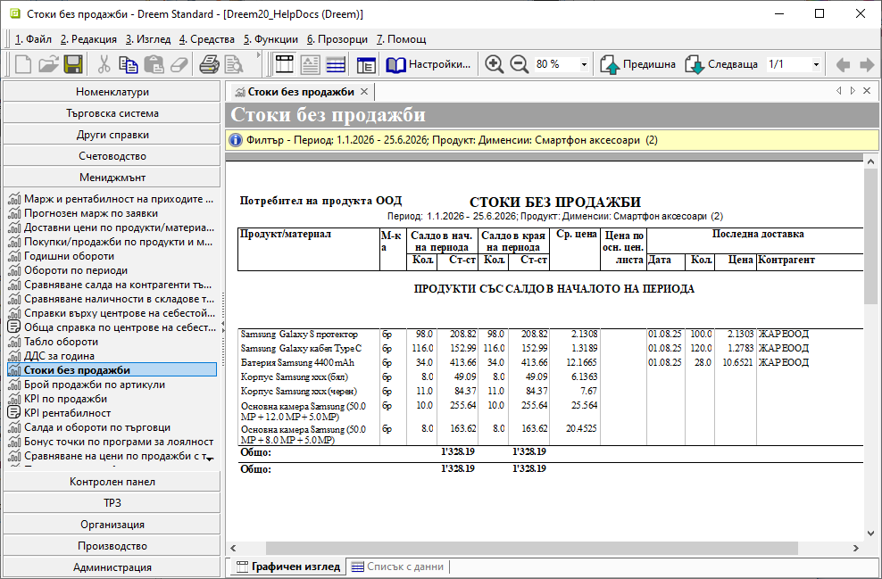
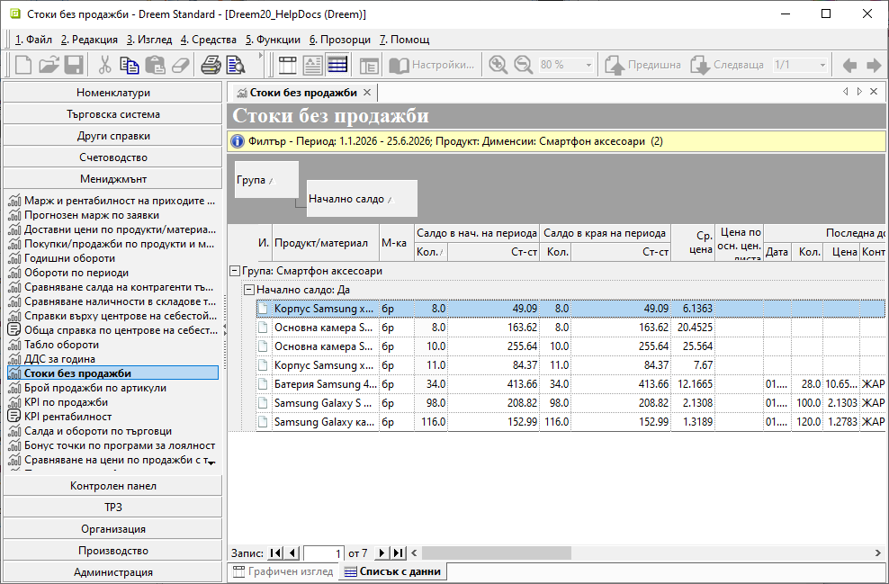

```{only} html
[Нагоре](../000-index)
```

# **Стоки без продажби**

Справка **Стоки без продажби** е достъпна от меню **Мениджмънт**.  
Показва всички стоки и техните салда, за които сумарно количество по продукт и мярка в избрания период е 0 (нула). Справката проверява за продажби поотделно за всяка мярка на продукта.  

> Началното и крайното салдо се изчисляват за избраните складове, а продажбите се проверяват независимо от избора на склад.  

Обхватът на справката може да бъде ограничен до отделни продукти, дименсии и/или типове на продукти. Филтър формата съдържа следните опции за избор на критерии:  

{ class=align-center }

В раздел **Основни**:  

- **От дата** и **До дата** - В тези полета се указва период, за който се филтрират данни.  
Ако останат празни, системата приема, че периодът е текущият ден.  

- **Склад** - От полето могат да бъдат избрани един или няколко склада.    
Ако остане празно, справката ще включва обобщени данни за всички складове, до които потребителят има достъп.  

В раздел **Продукт/материал/услуга**:  
От този раздел се прилагат критерии за филтриране за един или няколко параметъра: **Продукт**, **Дименсии** и **Тип**. Отнасят се и към продажбите, и към складовия оборот.   

В раздел **Контрагент**:  
От този раздел могат да бъдат приложени критерии за филтриране по **Последен доставчик**.  
Справката търси последната приключена покупка от избрания доставчик. Търсенето е по продукт без ограниченита **От дата**-**До дата**, така че последна доставка може да е извън периода.    

{ class=align-center w=15cm }

От изглед **Списък с данни** справката може да бъде групирана и сортирана по различни критерии. Например могат да бъдат изведени продуктите без продажби, за които няма наличност в указания склад/ове.  

{ class=align-center w=15cm }