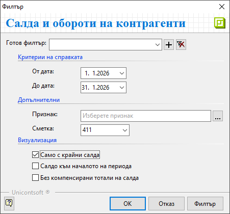

```{only} html
[Нагоре](../000-index)
```

# **Салда и обороти на контрагенти**

Справката **Салда и обороти на контрагенти** е достъпна от меню **Счетоводство**.  
Проследява данни по счетоводни сметки с вземания и задължения за контрагенти. Справката включва начално салдо за годината, обороти и крайно салдо по счетоводна сметка и признак.  

Филтър формата съдържа няколко опции с критерии за справката.  

{ class=align-center } 

- **От дата** и **До дата** - В тези полета се указва времеви обхват за справката.  
Датите трябва да са в една календарна година. **От дата** трябва да е преди или равна на **До дата**. В оборота през периода участват приключени счетоводни документи по отчетна дата, като и двете граници са включени.  

- **Признак** - От бутона [**...**] след полето се отваря списък със счетоводни признаци. Може да бъде избран само един контрагент, за който се генерира справка.  
Полето може да остане празно, така че справката да включва всички контрагенти (вкл. записи без признак).  

- **Сметка** - Полето е задължително. В него се отваря списък с настроения **Сметкоплан**.  
Справката ще включва сметките, чиито кодове започват с избрания в полето код.  

- **Само с крайни салда** - Чрез отметка справката генерира редовете с ненулево крайно салдо, дебитно или кредитно.   

- **Салдо към началото на периода** - При активиране на опцията се визуализира колона **Салдо към началото на периода**. С това справката показва салдото към **От дата**, изчислено от началното салдо за годината и оборота преди периода.  
Без отметка на същото място се показва **Оборот до началото на периода**. Той обхваща отчетните дати от 1 януари до деня преди **От дата** (включително).  

- **Без компенсирани тотали на салда** - Определя дали в обобщенията по сметки дебитните и кредитните салда се сумират отделно, или се прихващат едно срещу друго.  
С отметка дебитните и кредитните салда се сумират отделно. Това засяга салдото към началото на годината, салдото към края на периода и салдото към началото на периода, когато справката показва него вместо *Оборот до началото на периода*.  
Без отметка салдата се компенсират първо по подсметка, после по основна сметка.  