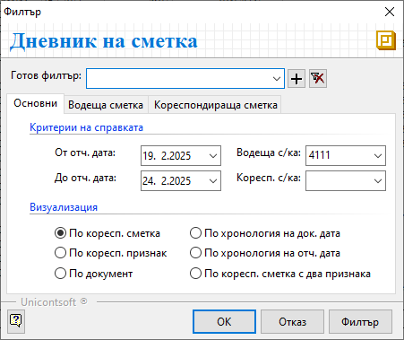

```{only} html
[Нагоре](../000-index)
```

# **Дневник на сметка**

Справка **Дневник на сметка** е достъпна от меню **Счетоводство**.  
Проследява операциите от приключени счетоводни документи за избрания период по отчетна дата. Справката показва водещата и кореспондиращата сметка, дебитните и кредитните обороти и, според визуализацията, данни за документите и признаците.  

Филтър формата съдържа различни опции с критерии за справката.  

{ class=align-center } 

В раздел **Основни**:  

- **От отч. дата** и **До отч. дата** - В тези полета се указва времеви обхват за справката.  

- **Водеща с/ка** - Избира се водещата сметка от **Сметкоплан**.  
Справката включва избраната сметка и подсметките, чиито номера започват с нейния код (напр. при избор на 411 се включват и записите по 4111 и 4112, ако има такива).  

- **Коресп. с/ка** - Избира се кореспондираща сметка от **Сметкоплан**.  
Справката включва кореспонденциите с избраната сметка и с подсметките, чиито кодове започват със същите цифри. Ако полето остане празно, се показват всички кореспонденции на водещата сметка, които отговарят на останалите критерии.  

- **Визуализация** - Чрез опциите се избира формат на справката - по документи, по хронология, по кореспондиращи сметки и/или признак. Вариантът с два признака показва признаците и на водещата, и на кореспондиращата сметка.  
Изборът определя колоните, групирането и подреждането.  

В раздел **Водеща сметка**:  
Търсенето може да се ограничи по избрани критерии, отнасящи се до основната сметка - признак, документ тип, документ номер, документ дата, валута или мярка.  

В раздел **Кореспондираща сметка**:  
Опциите в този раздел обхващат критерии, касаещи кореспондиращата сметка.  

> **Начално салдо** се формира от началното салдо за годината и оборотите до деня преди **От отч. дата.** Към него се прилагат критериите за водещата сметка.  
**Крайно салдо** се изчислява като към това начално салдо се добавят оборотите, включени в справката за периода. Затова при избрана **Коресп. с/ка** началното салдо остава за водещата сметка, а крайното отразява само включения оборот с избраната кореспонденция.  