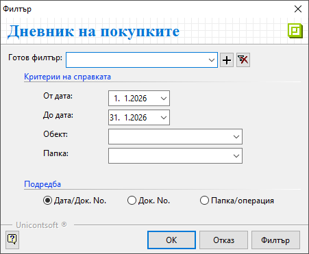

```{only} html
[Нагоре](../000-index)
```

# **Дневник на покупките**

Справка **Дневник на покупките** е достъпна в меню **Счетоводство**.  
Проследява данъчни документи за покупка за избран период.  
Справката е изготвена според указанията на НАП и покрива критериите за структуриране на информацията за:  
   - Вид, номер и дата на документ  
   - Контрагент - идентификационен номер и наименование  
   - Вид на стоката/услугата  
   - Данъчна основа и ДДС, разпределени по колони в дневника според вида на сделката  

> Справката показва всички покупки с приключени счетоводни документи.   
Включва и анулирани документи от определена група, като показва сумите им с нулеви стойности.  

Филтър формата съдържа няколко опции с критерии за справката.  

{ class=align-center } 

- **От дата** и **До дата** - В тези полета се указва времеви обхват на справката.  
Справката използва отчетната дата на първия заглавен счетоводен запис. При липса на такава използва датата на документа.  

- **Обект** - Поле за избор на един или няколко обекта, за които се визуализират данни в справката. Филтърът проверява обекта от документа за покупка.   

- **Папка** - Ограничава справката за избрани една или няколко папки от настроените в **Референтни номенклатури » Счетоводство**.  
При празно поле справката обхваща и документи без зададена папка, ако отговарят на останалите условия.  

- **Подредба** - Опциите променят реда на документите.    
Вариантите за водещи критерии при сортиране на документите са:  
    - Дата и номер на документа;  
    - Номер на документа;  
    - Папка и операция;  

> Редовете, маркирани за касова отчетност, се виждат в справката в сиво и курсив.  
Когато по тях има ненулеви суми, справката ги показва в **Изключени по касова отчетност от общо за деклариране** и ги изважда от **Общо за деклариране**.  