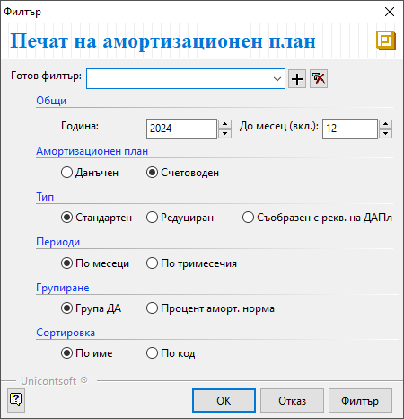

```{only} html
[Нагоре](../000-index)
```

# **Амортизационен план**

Справка **Печат на амортизационен план** е достъпна от модул **Счетоводство**.  
Проследява амортизационна норма, начислена амортизация, балансова стойност и други данни.  

Показва списък с дълготрайни активи, отбелязани като активни, придобити до края на избрания месец и с положителна амортизационна норма за избрания план. Подборът зависи от периода, вида на плана и настройките на актива.  

> Актив с дата на отписване преди началото на годината отпада.  
В данъчния план отпадат и активите без месечни записи за периода, освен ако са придобити през него. Затова придобит през периода актив може да се покаже и преди да има начислена амортизация.    

Филтър формата съдържа няколко опции с критерии за справката.  

{ class=align-center } 

- **Общи** - Секцията включва критерии за определяне на времевия обхват на справката.  
Справката обхваща периода от 1 януари до последния ден на избрания месец включително.    
   - **Година** - Избира се година да бъде генерирана.  
   - **До месец** - Указва месец, чийто последен ден е и крайна дата 
за периода на справката.  

- **Амортизационен план** - Определя дали справката да представи счетоводен или данъчен амортизационен план.  

- **Тип** - Указва формат на амортизационния план - стандартен, редуциран или съобразно реквизитите на ДАПл.   

- **Периоди** - В полето се избира дали амортизационният план да бъде генериран по месеци или по тримесечия.  

- **Групиране** - Опцията указва как се представят данните:  
   - *Група ДА* - Счетоводният план се групира по група на актива, а данъчният — по данъчна категория.  
   - *Процент аморт. норма* - Групирането е по годишната амортизационна норма.    

- **Сортировка** - Сортировката определя дали списъкът с дълготрайни активи ще се подреди по име или по код.  

___  
## Свързани статии

[Дълготрайни активи](../../005-how-to/010-fixed-assets.md)