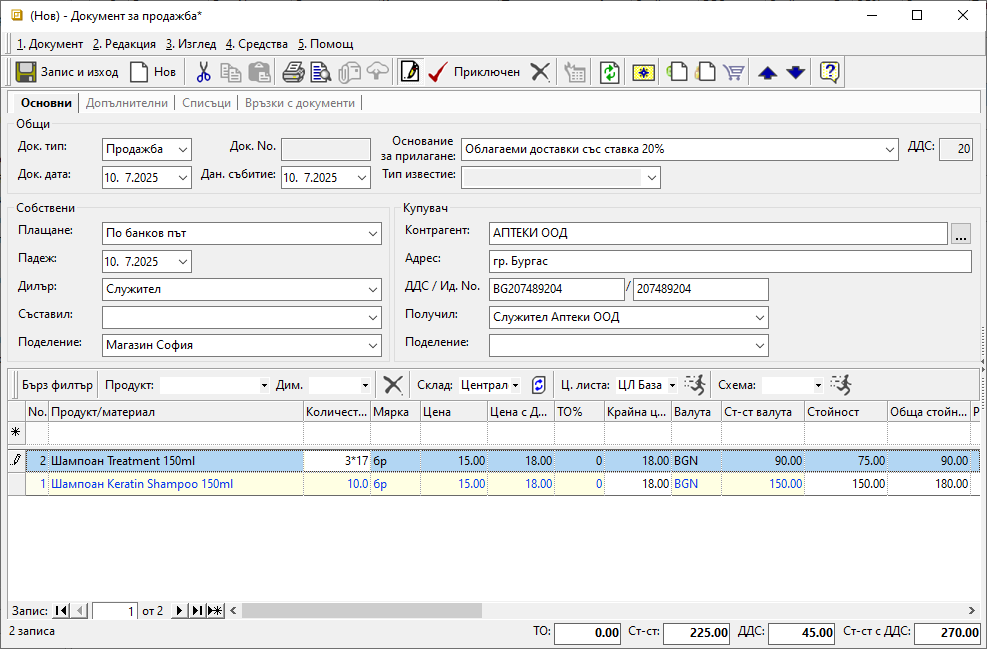
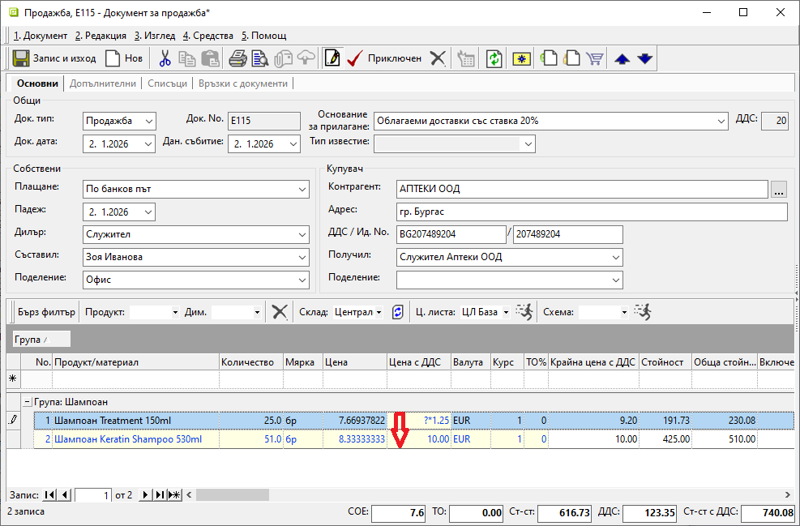

```{only} html
[Нагоре](000-index)
```

# **Вграден калкулатор**

В системата има реализиран инструмент за автоматични калкулации.  
Позволява основни математически операции като събиране, изваждане, умножение, деление.  

Той е достъпен в редактируеми числови клетки от формите за редакция на номенклатури и документи. Такива са **Количество**, **Цена (Цена с ДДС)**, **ТО%**, **Ст-ст валута** и подобни.    

> Вграденият калкулатор работи за документите в състояние на редакция.  

Позиционирайте се в избраното поле и въведете желаната операция (напр. **17*3**).  
Потвърдете действието с бутон [**Enter**]. Системата преизчислява новите стойности.  

{ class=align-center w=15cm }

> Калкулаторът е ефективно средство за бързо преизчисляване на стойности в множество редове.  
Чрез него може да приложите формула, която да размножите по редове нагоре/надолу.   

Пример:  
За да увеличите **Цена с ДДС** с 25% за всички продукти в продажбата, изберете първия ред в колоната.  
Маркирайте текущата цена и на нейно място въведете формулата: ?*1.25. Докато формулата още е в клетката, задръжте **Ctrl+Shift+↓**, докато стигнете до последния ред.  

Ако започвате от последния ред, използвайте **Ctrl+Shift+↑**.  

{ class=align-center w=15cm }

За всеки ред системата умножава неговата досегашна цена по 1.25.   
Успоредно се актуализират и тоталите на документа.  
