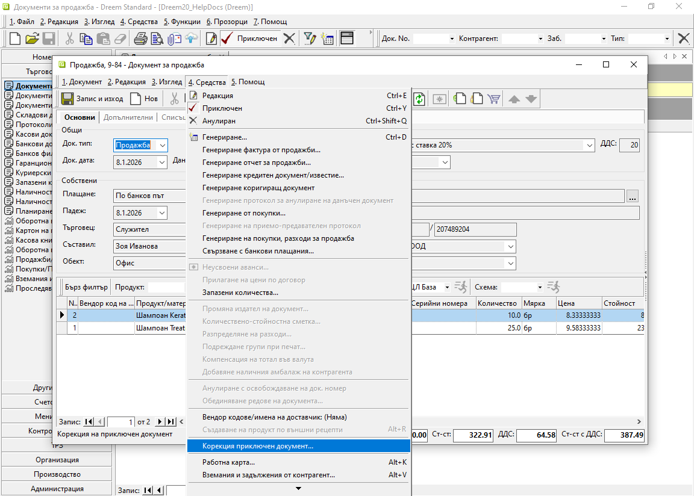
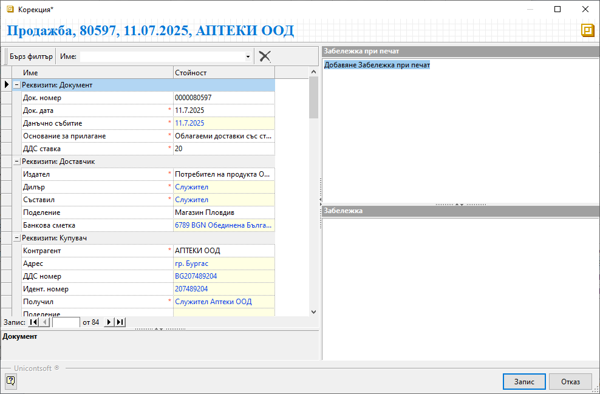

```{only} html
[Нагоре](000-index)
```

# **Корекция приключен документ**

Често, заради пропуск или грешка, се налага редактиране на вече валидиран документ в системата. В общия случай той може да бъде върнат в редакция. Това дава достъп до пълното му съдържание за нанасяне на корекции.  

В системата има още един вариант за редактиране - вграден инструмент **Корекция приключен документ**.  
Той е достъпен във формата за редакция на документите за покупка и за продажба от меню **Средства**.  

> При използване на **Корекция приключен документ** не променяте състоянието на документа. Той остава приключен.     

{ class=align-center w=15cm }

Системата отваря форма **Корекция приключен документ** с избрани реквизити на документа.  
Можете да променяте данните във всяко от жълтите полетата, както и да добавите *Забележка* и/или *Забележка при печат*.  

{ class=align-center w=15cm }

Потвърдете направените промени с бутон [**Запис**].  
Системата попълва новите данни в документа, като запазва неговото състояние по време на процеса.  

> Позволените за редакция реквизити могат да се различават за [покупките](../002-docs/001-trade-system/001-orders-sales-purchase-documents/002-create-purchase-documents.md#реквизити) и [продажбите](../002-docs/001-trade-system/001-orders-sales-purchase-documents/003-create-sales-document.md#форма-корекция-приключен-документ).  