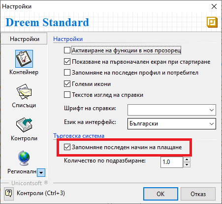
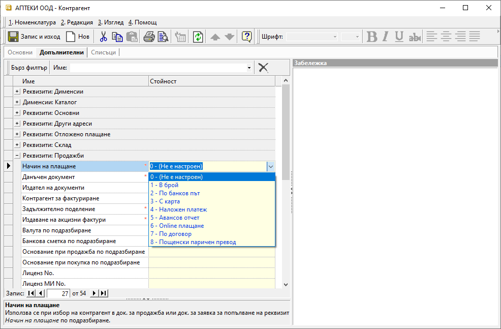

```{only} html
[Нагоре](000-index)
```

# **Начин на плащане**

Системата разполага с различни настройки, чрез които начин на плащане се попълва автоматично в нов документ.  

Едната възможност е прилагане на последно използвания начин на плащане. Системата го следи и прилага отделно за покупките и за продажбите.  

Друга възможност е индивидуалната настройка по контрагенти.  
Така в нов документ се прилага дефинираният за контрагента начин на плащане.   

> С приоритет за системата са настройките на контрагента.  
Ако той има дефиниран индивидуален начин на плащане, останалите настройки не се прилагат.  

## Последен начин на плащане

Отворете форма с настройки **Dreem Standard** от основното меню чрез **Средства » Настройки**. Опцията **Запомняне последен начин на плащане** е достъпна в секция **Контейнер**. Активирайте я чрез поставяне на отметка и потвърдете промените с бутон [**Ок**].  

{ class=align-center }

## Начин на плащане по контрагент

Индивидуална настройка дефинирате от формата за редакция на избрания контрагент.  
В раздел **Допълнителни » Реквизити: Продажби** попълнете реквизит **Начин на плащане**. Потвърдете промените с бутон [**Запис и изход**].  

> Системата прилага тази настройка при нова продажба, след като контрагентът бъде избран.  

{ class=align-center w=15cm }
