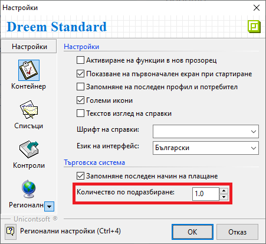

```{only} html
[Нагоре](000-index)
```

# **Количество по подразбиране**

При добавяне на нов ред в покупка, продажба, складов документ и други форми поле **Количество** се обзавежда с настройката по подразбиране. Първоначалната стойност е 1.  

Можете да промените първоначалната настройка в **Средства » Настройки** от лентата с основно меню.  
Навигирайте се до секция **Контейнер**. В полето за **Количество по подразбиране** въведете желаната стойност.  
Запишете промените с бутон [**Ок**].

{ class=align-center }
