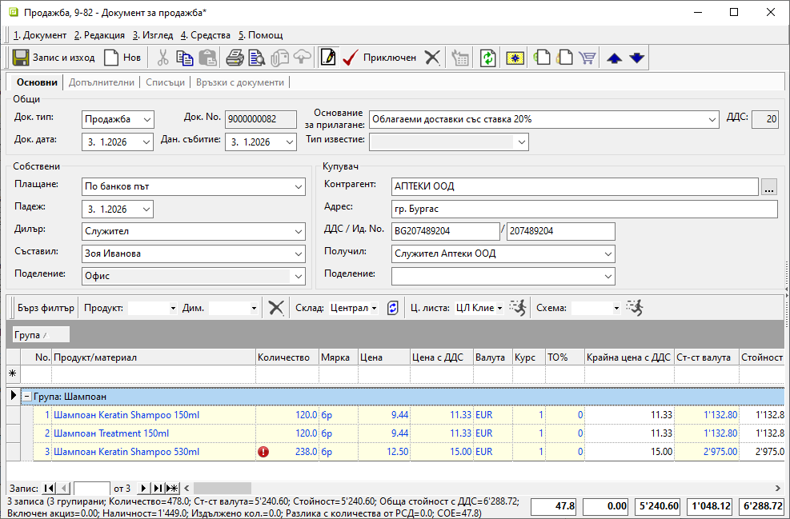
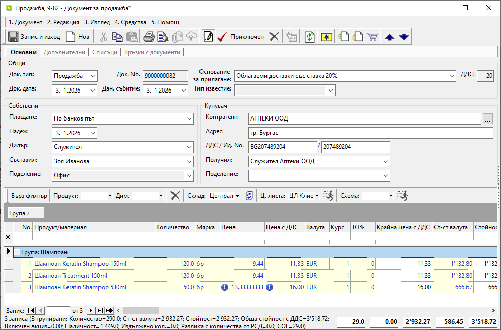
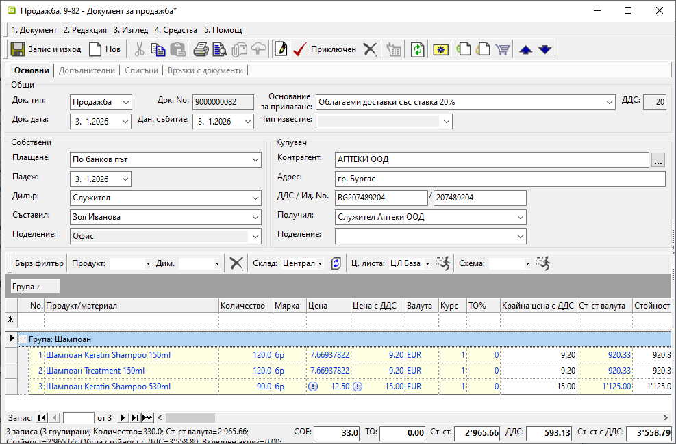
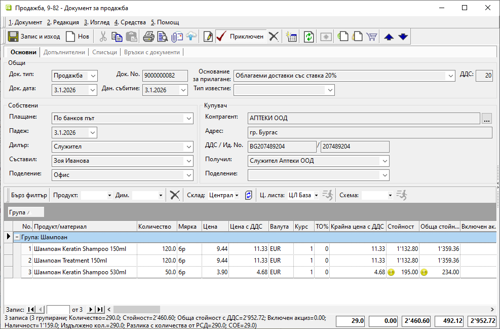

```{only} html
[Нагоре](000-index)
```

# **Знаци в документите**

В документите за заявка и продажба са заложени различни знаци. Те са по-скоро информативни с идеята да привлекат вниманието към възможни пропуски или грешки.  

> Знаците насочват вниманието към възможно несъответствие.  
Самото им показване не блокира обработката на документа.  
При запис и приключване системата изпълнява отделните проверки за съответния документ.  

1) **Червен знак с удивителна**  
Червеният знак се появява в колона **Количество**.  
Предупреждава, че въведената стойност надвишава разполагаемото количество за избрания в бързия филтър склад.  
В този случай не е възможно приключване на свързан разходен складов документ.  

{ class=align-center w=15cm }

2) **Син знак с удивителна**  
Този знак се появява в колони **Цена** и **Цена с ДДС**.  
Сигнализира, че цената в документа е различна от настройките на приложената ценова листа.  
При този знак системата не ограничава валидирането на текущия и на свързаните документи.  

{ class=align-center w=15cm }

3) **Бял знак с удивителна**  
Знакът се появява в колони **Цена** и **Цена с ДДС**.  
Показва, че продуктът няма настроена цена в приложената ценова листа.  
Не влияе върху приключването на документи.  

{ class=align-center w=15cm }

4) **Жълт знак с удивителна**  
Знакът се появява в колони **Стойност** и **Обща стойност с ДДС**, когато има генериран свързан складов документ.  
Предупреждава, че цената в продажбата е по-ниска от себестойността (цената в складовия документ).   
Не влияе върху приключването на документи.  

{ class=align-center w=15cm }

```{tip}
Щракването върху знак показва обяснение, което уточнява причината.  
Според случая посочва ценовата листа, схемата за отстъпки или склада.  
```