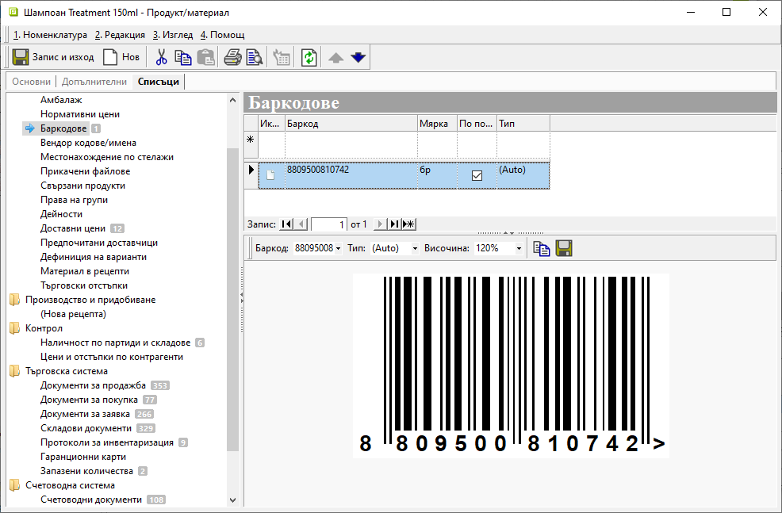
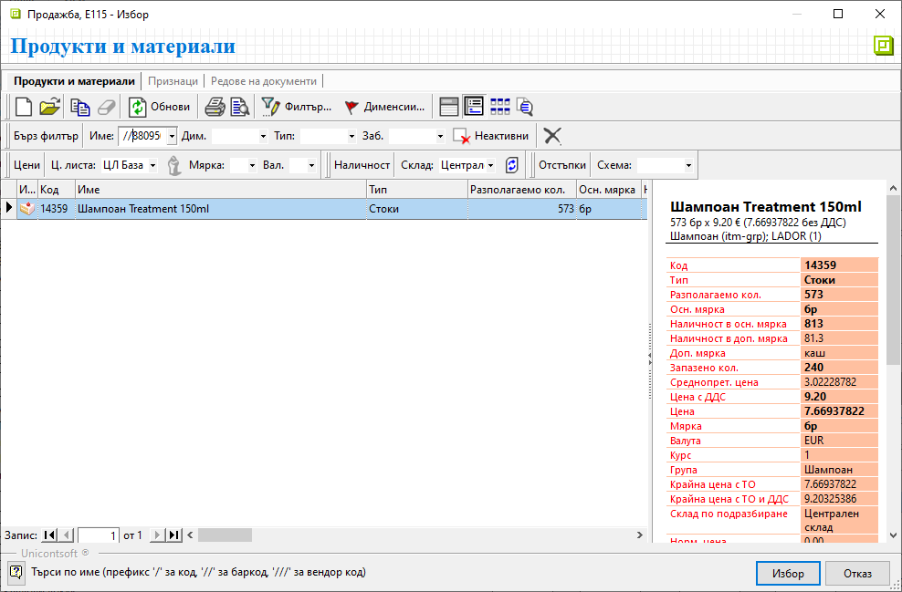
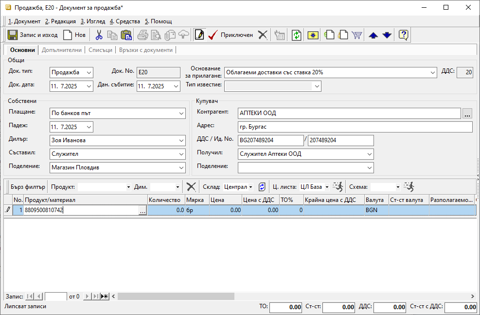
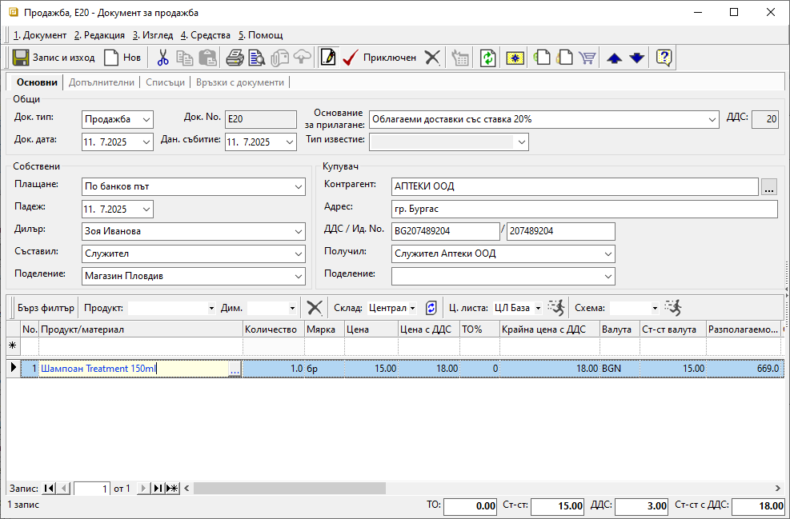

```{only} html
[Нагоре](000-index)
```

# **Работа с баркод скенер**

Сканирането на баркодове служи за идентифициране и автоматично попълване на продукти в документи. За да се осъществи на практика в системата, се изисква:  
- Към машината да има настроен баркод скенер  
- За всички продукти да бъдат настроени баркодове   

Баркод може да добавите/редактирате от форма за редакция на продукт в раздел **Списъци**.    

{ class=align-center w=15cm }

Баркодът се използва като критерий за търсене в полетата за въвеждане на продукт.  
Такива има в бързите филтри (поле **Име**), във филтър формите, в редове за добавяне на нов запис в документи, номенклатури и др.(поле **Продукт/материал**).   

{ class=align-center w=15cm }

За да реализирате търсене, позиционирайте курсора в полето за продукт.  
След това маркирайте баркода със скенера.  

{ class=align-center w=15cm }

При разпознаване на продукта системата попълва полето.  

{ class=align-center w=15cm }

> Ако системата не разпознае еднозначно продукт по баркода, според настройките за избор от списък се отваря форма **Продукт/Материал** или се подава звуков сигнал.  
Проверете дали баркодът е въведен за продукта и дали зададените филтри позволяват той да бъде намерен.  