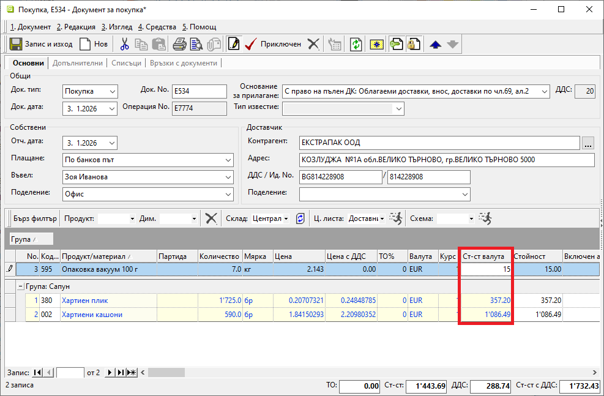

```{only} html
[Нагоре](000-index)
```

# **Автоматична единична цена**

В документите за покупка и продажба има вграден инструмент за автоматично изчисление на единична цена. Калкулацията работи на база въведени за продукта количество и обща стойност.  

Служи при въвеждане на покупка, когато закръглението на цените в получения документ затруднява неговото въвеждане. Това позволява да въведете коректно всеки документ, независимо до кой знак е бил отпечатан от доставчика.  

В нов документ добавете продуктите с количества, различни от нула.  
Попълнете полета **Ст-ст валута** по редовете:  
   - **Покупка** - При обичайна покупка се въвежда стойността без ДДС.   
   - **Продажба** - При продажба с включен ДДС се въвежда стойността с ДДС.  

Системата изчислява единична цена, като отчита количеството и отстъпката, и преизчислява стойностите на реда.   

{ class=align-center w=15cm }

> Ако колона **Ст-ст валута** не се вижда, изведете я чрез **Изглед на списък** от контекстното меню.   