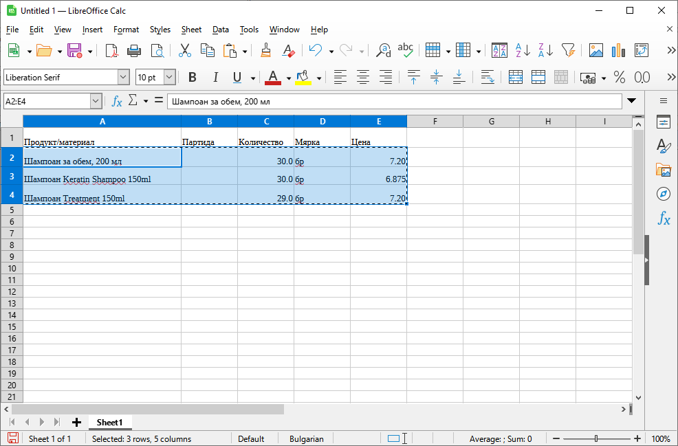
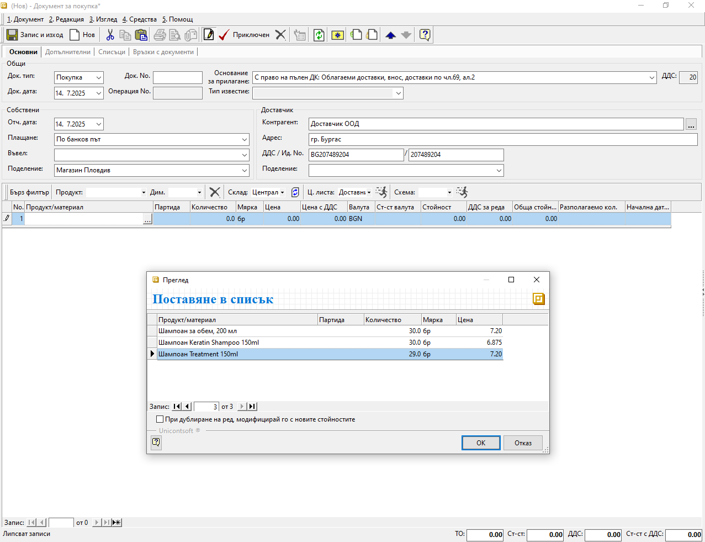
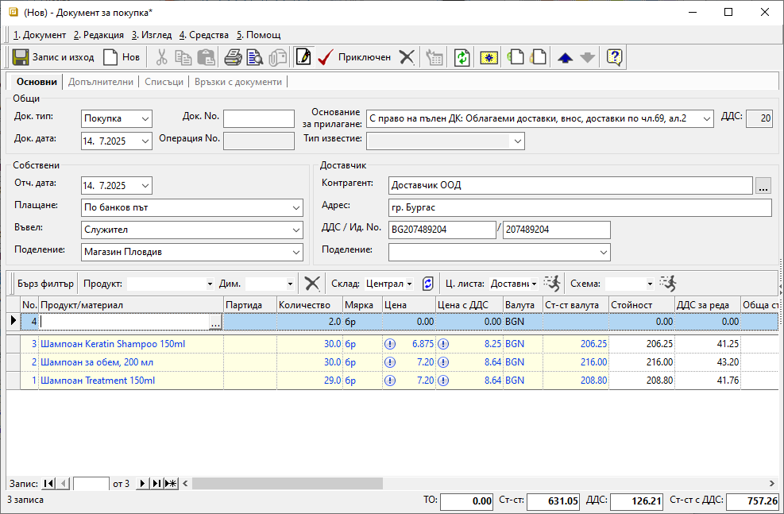

```{only} html
[Нагоре](000-index)
```

# **Копиране на списък**

В системата е реализирано копиране на списък с данни за продукти. Копирането работи както между документи в системата, така и от външен файл (напр. Excel).  

> За да се реализира копирането, системата трябва да идентифицира продуктите. Това изисква продуктите да бъдат настроени идентично при източника и при получателя на данните.  

Разпознаването (по име, код, баркод) използва общия механизъм за търсене на продукт и неговите настройки.  

1) **Копиране на данните** - Маркирайте данните в списъка-източник. Копирайте с клавишна комбинация **Ctrl+C** или чрез десен клик и опция *Копиране*.     
При копиране между списъци в **Dreem** първо се съпоставят колоните по наименование. Ако няма съответствие, се проверява по вътрешния идентификатор на колоната.  

   > При копиране от външен файл подредете колоните в електронната таблица в същата последователност, както видимите редактируеми колони в списъка, в който ще поставите данните.    

{ class=align-center w=15cm } 


2) **Поставяне на данните** - Позиционирайте се в поле **Продукт/материал** на реда за добавяне на нов запис. Поставете копираните данни с клавишната комбинация **Ctrl+V** или с десен клик и *Постави*.  

   Системата стартира процес по идентифициране и извежда форма **Поставяне в списък**.  
   С бутон [**Ок**] потвърдете добавянето на разпознатите данни в редовете на документа.  

{ class=align-center w=15cm } 

Ако всички данни бъдат добавени успешно, форма **Поставяне в списък** се затваря автоматично.   
При грешки тя остава отворена с останалите редове и описание на проблемите. Коригирайте данните и повторете поставянето.  

{ class=align-center w=15cm } 
