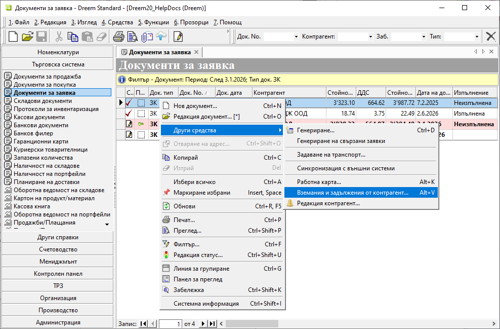
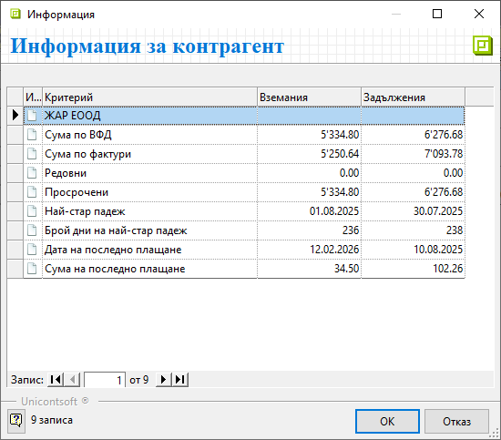
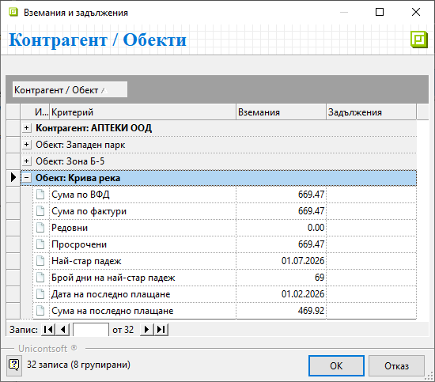

```{only} html
[Нагоре](000-index)
```

# **Бърза справка за контрагент**

В системата може да бъде показана кратка справка с вземания и задължения общо за контрагент и отделно по негови обекти. Тя е достъпна от **Търговска система** за документите за продажба, покупка и заявка.  
Формата с информация за избран контрагент можете да отворите от:  

- **Списък с документи, контрагенти или обекти на контрагенти**  

За да отворите справката от списък, маркирайте запис с избрания контрагент/обект. С десен клик изберете **Други средства » Вземания и задължения от контрагент**.  

{ class=align-center w=15cm }

- **Форма за редакция на документ, контрагент или обект**  
    - **Контрагент/ Обект на контрагент** - Отворете формата за редакция на избрания контрагент или обект на контрагент. От меню **Номенклатура** изберете **Вземания и задължения от контрагент**.  
    - **Документ** - Отворете формата за редакция на избрания документ. От меню **Средства** изберете **Вземания и задължения от контрагент**.  

{ class=align-center w=15cm }
   
В справката ще видите обща сума по ВФД, по фактури, редовни и просрочени остатъци, най-стария падеж и броя дни от него, както и дата и сума на последното плащане.  

{ class=align-center }
