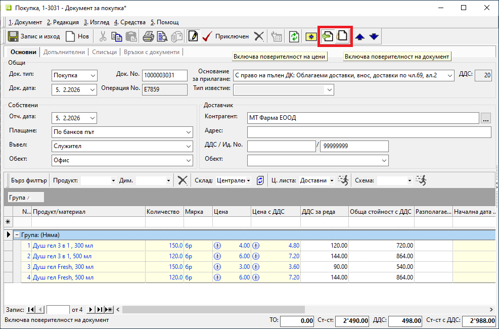

```{only} html
[Нагоре](000-index)
```

# **Поверителност в документи**

Системата дава възможност за селективно скриване на данни в отделни документи.  
Настройката се използва като част от дефинирането на [**Права на групи**](../001-ref/004-settings/002-permissions.md).  

Индикатори за различен вид поверителност можете да прилагате за всеки тип документ.  
Поверителност за цени и/или за документи може да бъде дефинирана в продажба, покупка, заявка, договор, протокол за инвентаризация, складов или счетоводен документ.  
В гаранционна карта, планиране на производството, банков и касов документ може да бъде настроена единствено поверителност на документ.  

>  Наследяването на поверителност в свързани документ зависи от използваната команда.  
При генериране на фактура и складови документ от продажба наследяват нейната поверителност.  
При *Генериране на покупки, разходи за продажба* новата покупка се създава с изключена поверителност.   

Можете да управлявате достъпа до данните за избран документ, докато е в редакция.  
Чрез бутоните в лентата с инструменти можете да активирате и деактивирате следните ограничения:  

- **Включва поверителност на цени** - Служи като маркер за скриване на цените в избран документ. 
- **Включва поверителност на документ** - Служи като маркер за скриване на избран документ.  

{ class=align-center w=15cm }

```{tip} 
Промяната на поверителност може да бъде забранена чрез настройка за права на групи.  
Може да бъде настроено също при нов документ поверителността да бъде автоматично активирана.  
```