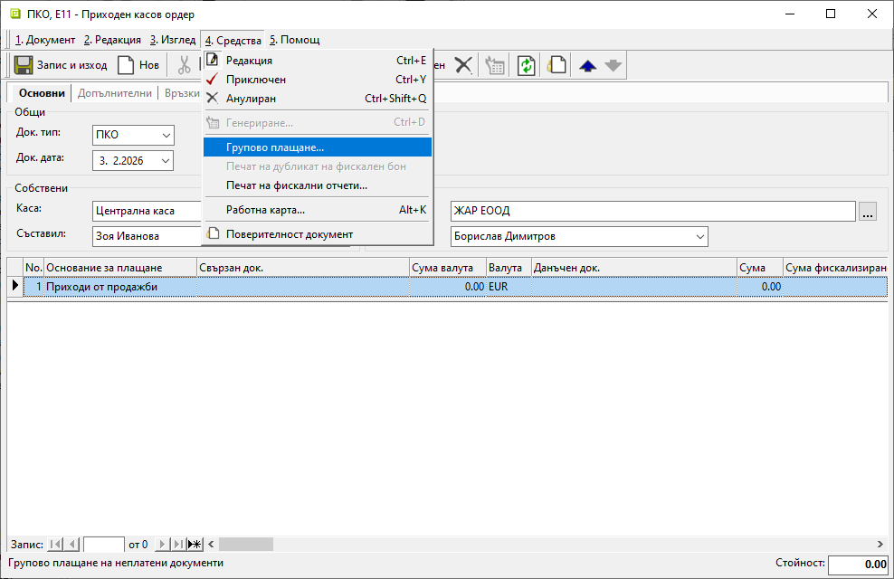
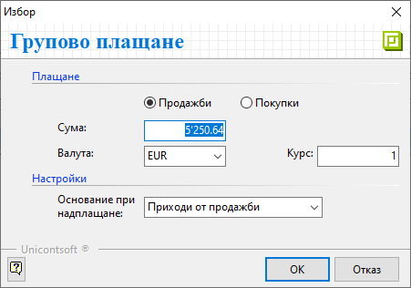
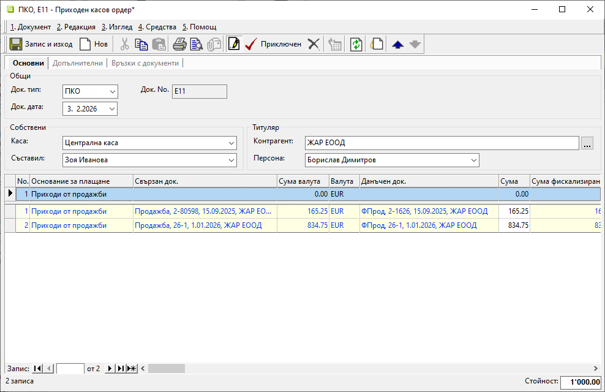

```{only} html
[Нагоре](000-index)
```

# **Групово плащане**

Системата разполага с инструмент за автоматично разплащане на множество покупки или продажби. Той е достъпен от **Търговска система » Касови документи** за записи в състояние на редакция.     

Създайте нов касов документ и попълнете контрагент. От меню **Средства** изберете опцията **Групово плащане**.     

{ class=align-center w=15cm }

Отваря се форма за избор на детайли за плащането.  
Маркирайте дали за контрагента се разплащат продажби или покупки. Поле **Сума** ще покаже тотал на остатъка за плащане към момента (**5250,64** евро). Редактирайте сумата, ако текущото плащане е различно от предложения остатък(**1000** евро).  
Изберете **Валута**, **Курс** и **Основание при надплащане**, които системата да попълни в касовия ордер.  

{ class=align-center }

Потвърдете избора с бутон [**OK**]. Системата добавя редове за плащане, като разпределя сумата по приключени вътрешнофирмени документи с неплатен остатък.
В **Свързан док.** се попълва съответната покупка или продажба от най-ранната дата на документа.  
Полето **Данъчен док.** се обзавежда, когато плащането по реда е отнесено към свързан приключен данъчен документ.  

{ class=align-center w=15cm }

> - При надплащане и указано *Основание при надплащане* се добавя отделен ред с празни полета **Свързан док.** и **Данъчен док.**.      
> - За последния документ се добавя ред за частично плащане, ако сумата покрива само част от остатъка.  