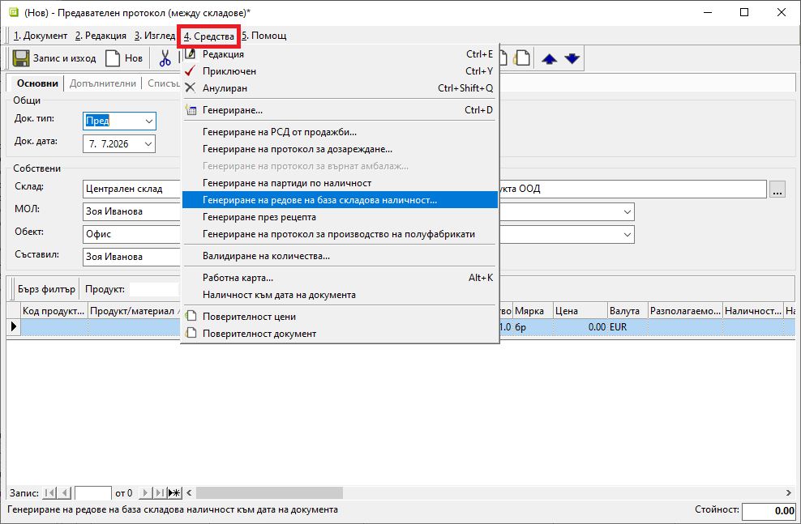
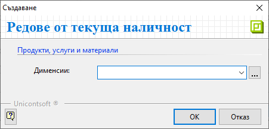
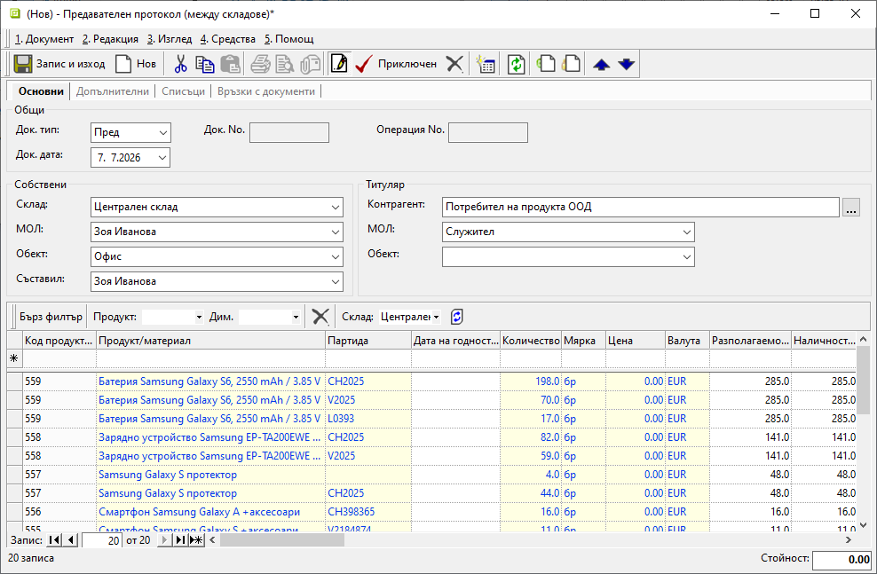

```{only} html
[Нагоре](000-index)
```

# **Генериране на наличности**

Системата разполага с инструмент за генериране на списък с налични продукти в избран склад.  
Той е достъпен в складови документи в редакция. Чрез него системата добавя отделни категории или всички продукти с наличност към датата на складовия документ.  
Генерирането на редове с наличност може да бъде използвано в различни ситуации, например за трансфер между складове.  

Създайте нов складов документ. В него трябва да укажете **Склад**, за който да се генерират наличности. От меню **Средства** изберете функцията **Генериране на редове на база складова наличност**.

{ class=align-center w=15cm }

Това отваря форма **Редове от текуща наличност** с поле за избор от списък с **Дименсии**.  
Можете да избирате отделни категории продукти (една или няколко дименсии), които да бъдат включени в документа.  
Ако оставите полето празно, системата ще генерира списък за всички продукти с ненулево количество или ненулева стойност.  

{ class=align-center }

Потвърдете с бутон [**OK**].  
Системата попълва **Количество** с крайното количество от справката. Ако вече има ред със същите продукт, партида, мярка и валута, количеството и цената му се заменят и стойността се преизчислява.  
При липса на съвпадение се добавя нов ред. Останалите редове в документа се запазват.  

{ class=align-center w=15cm }

Можете да редактирате списъка според нуждите на конкретната складова операция.  
Обработката на документа продължава без особености.  