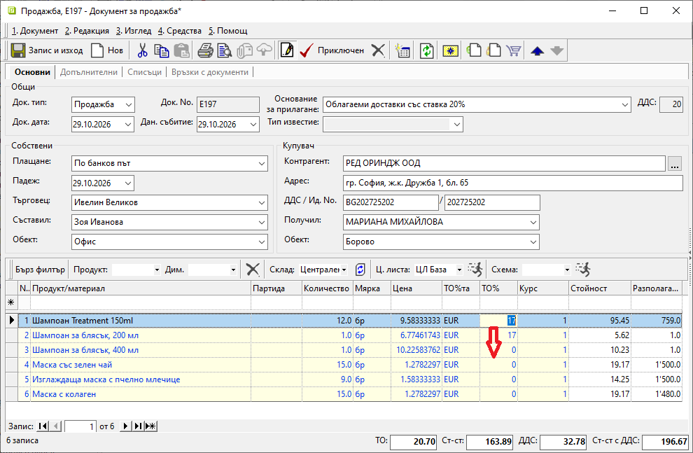

```{only} html
[Нагоре](000-index)
```

# **Масово копиране по редове в колона**

В системата има функция за масово попълване на съдържанието по редовете в колона.  
Тя е активна в полетата на редактируемите списъци (оцветени в жълто).    

> Функцията работа единствено в последователни редове.  

Позиционирайте се в избраното за копиране поле. Задръжте **Ctrl+Shift+стрелка** (надолу или нагоре) и копирайте съдържанието до желания ред в списъка.  

{ class=align-center w=15cm } 

С клавишна комбинация (без задържане) **Ctrl+Shift+End** копирате избраното поле надолу до края, а с **Ctrl+Shift+Home** - нагоре до началото на списъка.     
