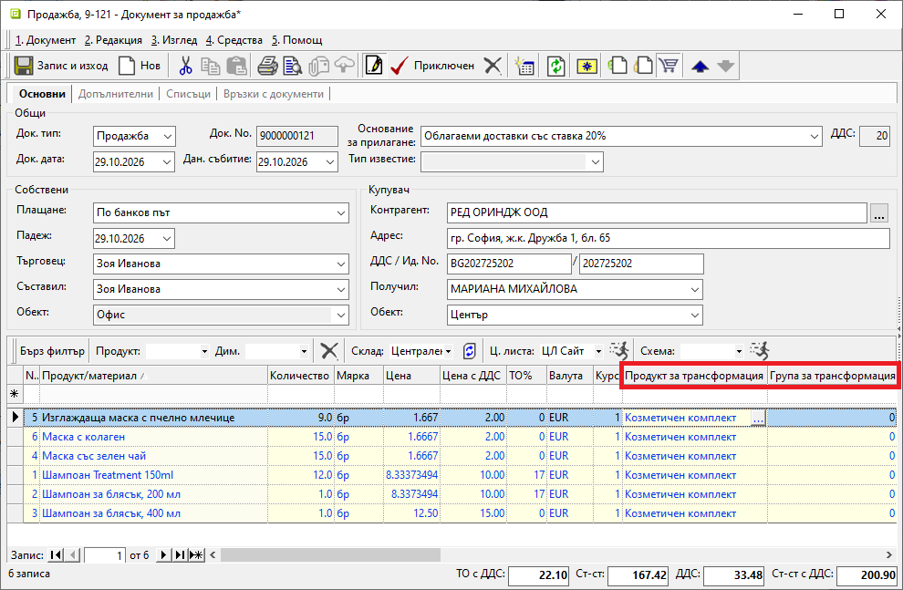
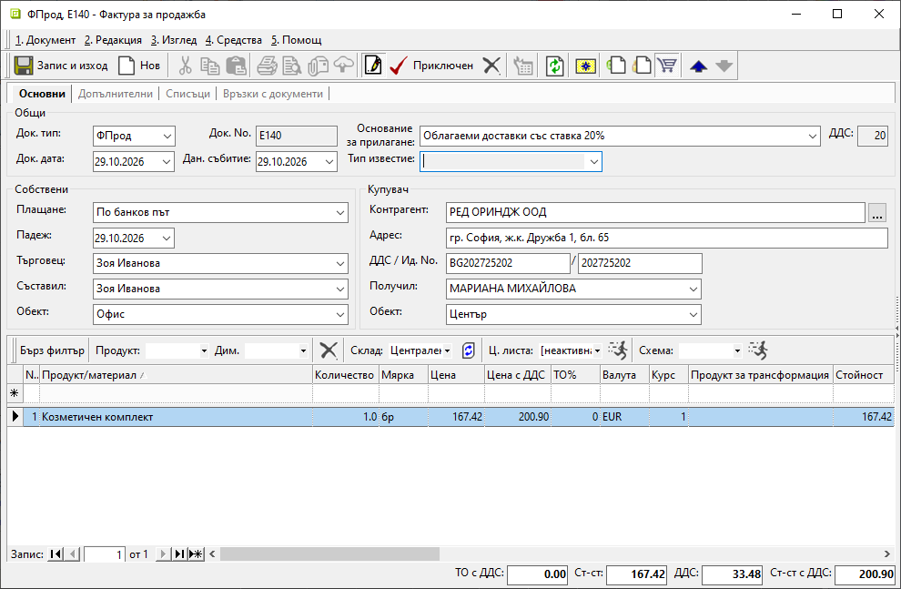
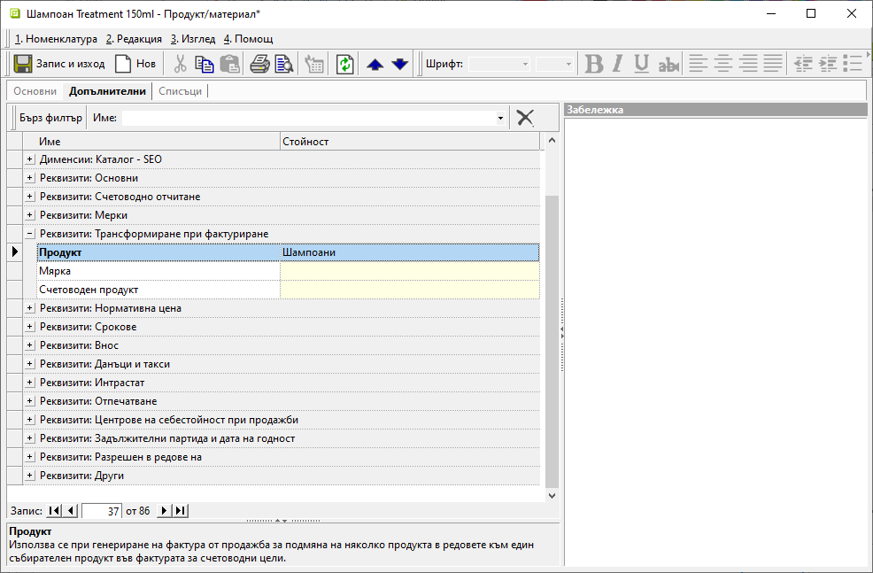

```{only} html
[Нагоре](000-index)
```

# **Обединяване на продукти при фактуриране**

В системата има функция, която позволява във фактурата да се покажат други продукти или обобщени редове, като се запази връзката с редовете на продажбата. 

> Всички събирателни продукти трябва да бъдат въведени като номенклатури в **Продукти и материали**.  

Системата прилага трансформиране единствено при изрично указване - в продажбата или в настройката на продукт. И в двата случая се създават нови редове във фактурата и се записват връзките им с продажбата. Оригиналните продукти в продажбата не се заменят от тази операция.  

1. **Трансформация, зададена в редовете на продажбата**  

В редовете на продажбата попълнете полета **Продукт за трансформация** и **Група за трансформация**. Ако не са видими, изведете чрез **Изглед на списък**.     

{ class=align-center w=15cm } 

При фактуриране редовете с един и същ продукт и група се обединяват.  
Цената се изчислява от сумата на включените редове, а отстъпката на получения ред е нула — тя вече е отразена в стойността.  

> Отделни редове остават при различни ДДС ставки, основания за ДДС, данъчни групи или настройки за отложен приход.  

{ class=align-center w=15cm } 

2. **Автоматична замяна според настройката на продукта**  

Добавете настройка във формата за редакция на продукта от **Допълнителни » Реквизити: Трансформиране при фактуриране**.  
В поле *Продукт* отваряте списъка с номенклатури и указвате продукта за трансформация.  
От поле *Мярка* за събирателния продукт също можете да изберете различна мерна единица.   

{ class=align-center w=15cm } 

> Настройката за продукт се проверява, ако редът в продажба няма зададен **Продукт за трансформация**.    
> Мерките и цените във фактурата се преизчисляват чрез настроените съотношения.    