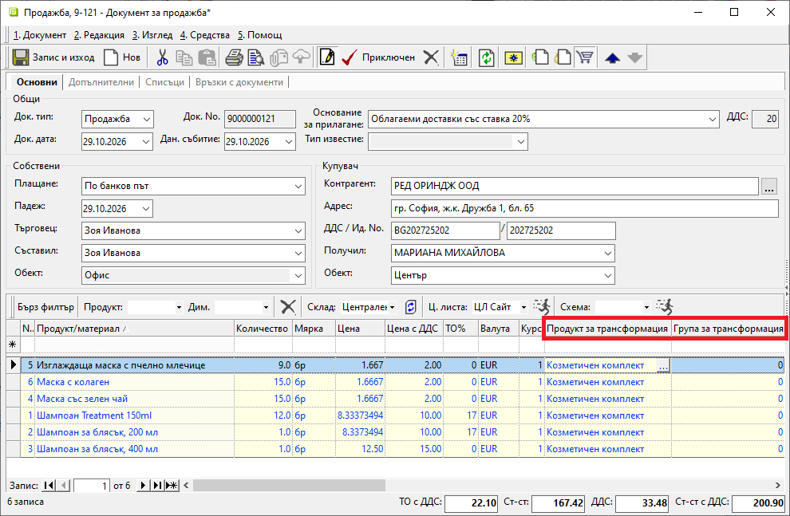
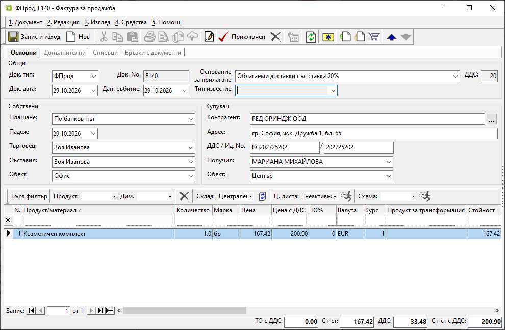
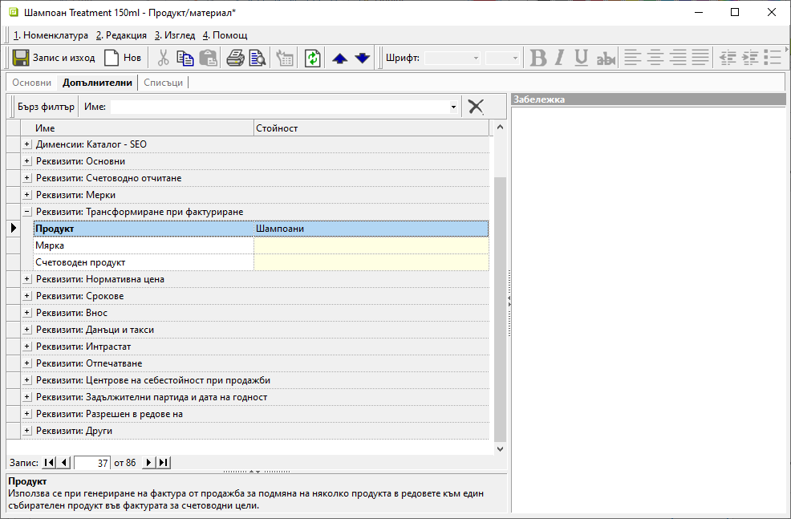

```{only} html
[Нагоре](000-index)
```

# **Трансформиране при фактуриране**

В системата има функция, която позволява във фактурата да се покажат други продукти или обобщени редове, като се запази връзката с редовете на продажбата. 

> Всички събирателни продукти трябва да бъдат въведени като номенклатури в **Продукти и материали**.  

Системата прилага трансформиране при изрично указване в настройките на продукт или в продажбата. Оригиналните продукти в продажбата не се заменят от тази операция.       

> Автоматичната замяна може да остави отделни редове за един и същ събирателен продукт при различни партида, цена, отстъпка, мярка за фактуриране, валута, валутен курс, признак за включен ДДС в цената, основание за ДДС, ставка на ДДС, данъчна група, начална/крайна дата на отложения приход, вид на отложения приход, допълнителен текст или забележка.  

1. **Трансформация, зададена в редовете на продажбата**  

> *Продукт за трансформация* от реда на продажбата се прилага с приоритет.   

В редовете на продажбата попълнете и двете полета **Продукт за трансформация** и **Група за трансформация**. Ако не са видими, изведете чрез **Изглед на списък**.     

{ class=align-center w=15cm } 

При фактуриране редовете с един и същ продукт и група се обединяват.  
Полученият ред е с количество 1 в основната мярка на събирателния продукт.  
Цената се формира от сумата на стойностите без ДДС на включените редове. Търговската отстъпка на обобщения ред е 0 (тя вече е отразена в стойността).  

> Отделни редове остават при различни ДДС ставки, основания за ДДС, данъчни групи или настройки за отложен приход.  

{ class=align-center w=15cm } 

2. **Автоматична замяна според настройката на продукта**  

> Настройката за продукт се прилага, когато няма зададен **Продукт за трансформация** в реда на продажбата.   

Добавете настройка в картона на продукта от раздел **Допълнителни » Реквизити: Трансформиране при фактуриране**. В поле *Продукт* указвате продукта за трансформация. Също можете да изберете различна мерна единица за събирателния продукт в поле *Мярка*. Ако остане празно, се използва основната мярка на събирателния продукт.  

{ class=align-center w=15cm } 
   
> Количеството и цените във фактурата се преизчисляват чрез настроените съотношения на мерки.      