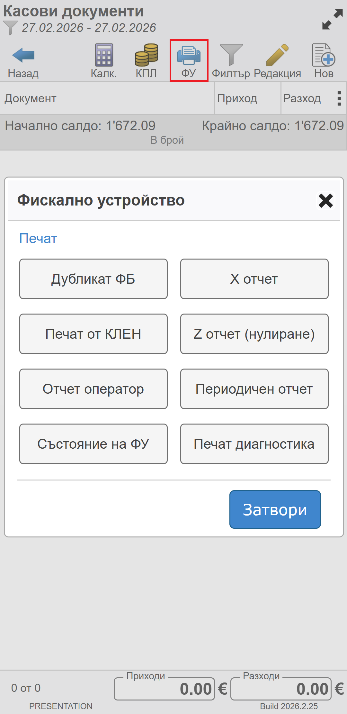
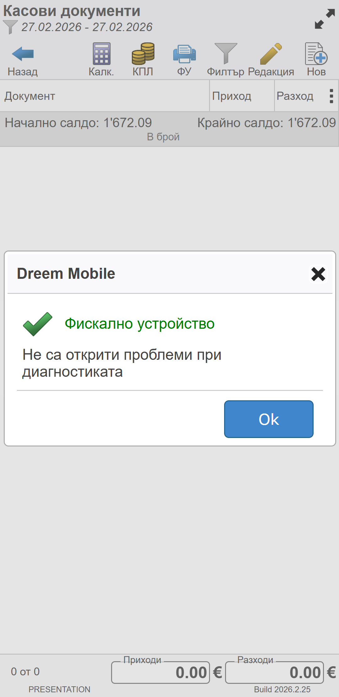

```{only} html
[Нагоре](../000-index)
```

# **Фискално устройство**

Формата за управление на фискалното устройство е достъпна във функционалност **Касови документи** от бутон [**ФУ**].  

{ class=align-center w=7cm }

## Състояние на ФУ 

Чрез бутон [**Състояние на ФУ**] от формата за управление **Фискално устройство** може да бъде определено състоянието на устройството за печат на бонове.  

Системата активира проверки като:   

   - коректност на дата;  
   - наличие на хартия;   
   - SIM карта;  
   - свързаност с мобилен оператор;  
   - проверка за неизпратени към НАП данни за над 24 часа и др.; 

След приключване на проверката системата ще изведе съобщение с резултата.  

{ class=align-center w=7cm }

## Печат диагностика

