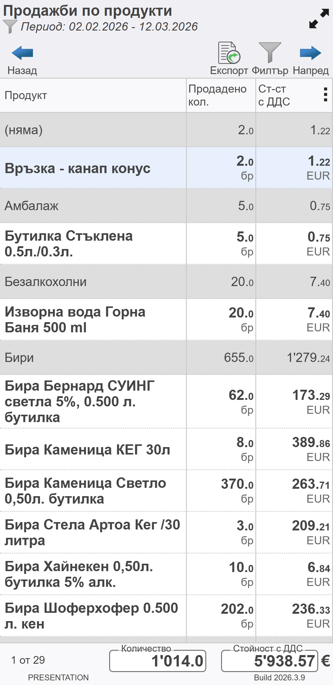
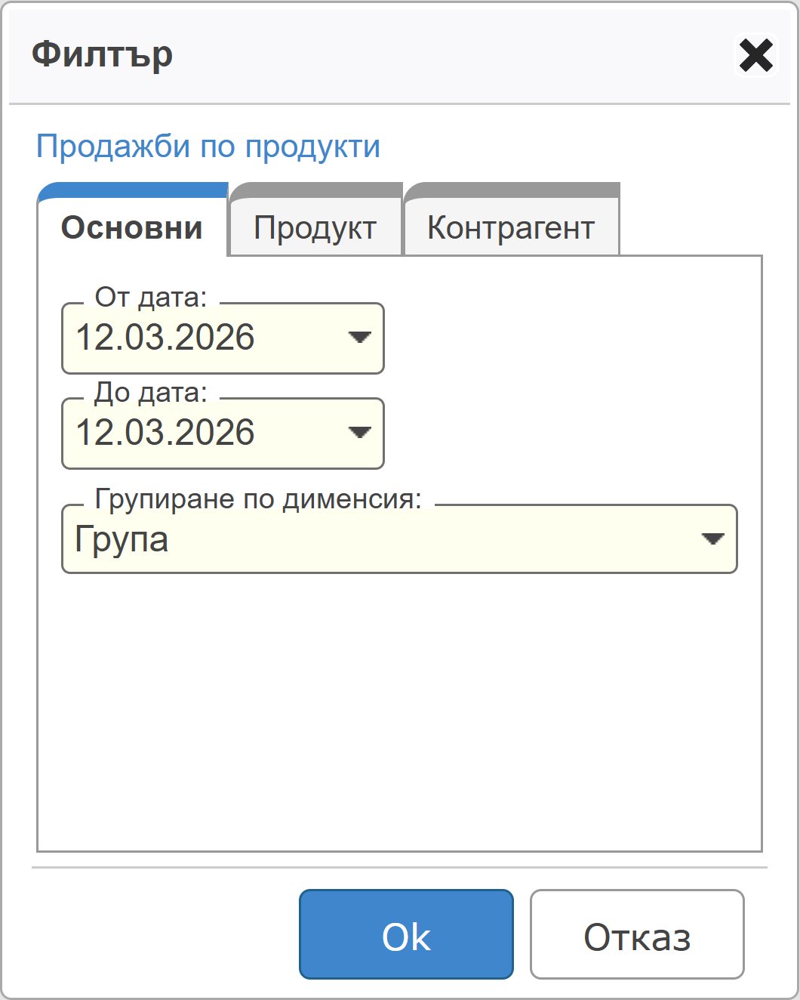
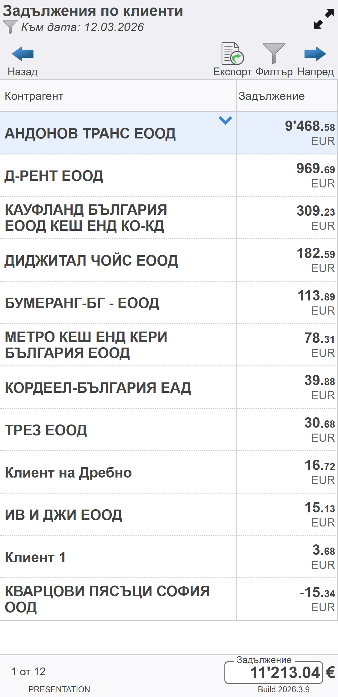
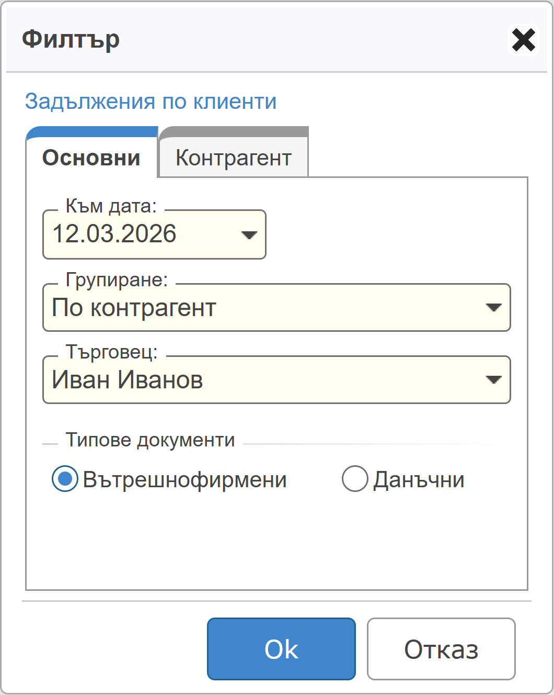
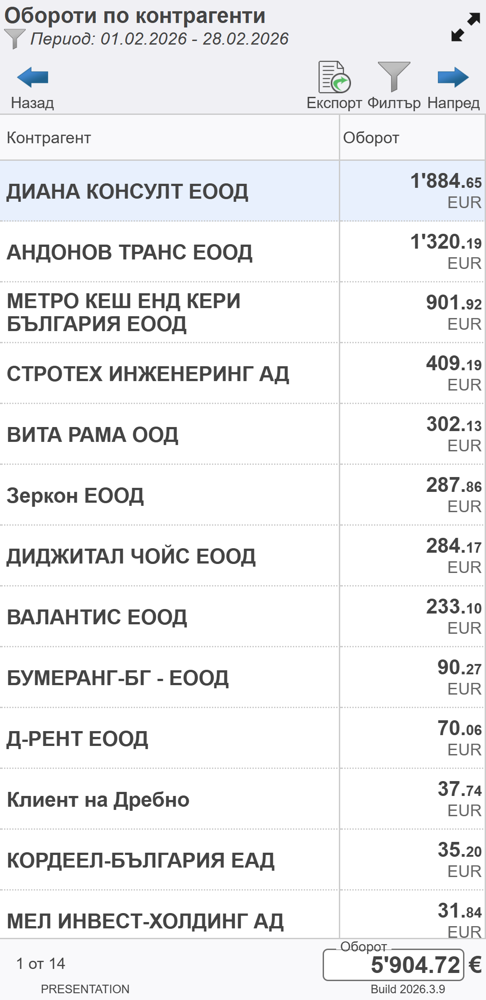
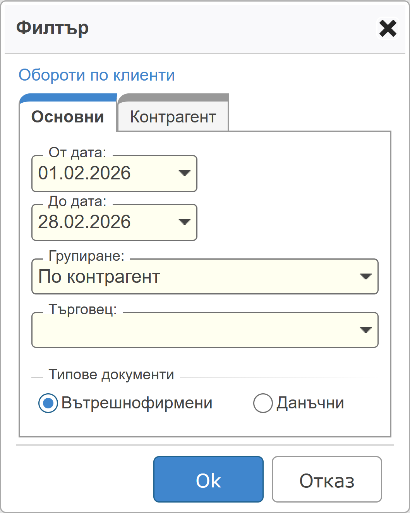
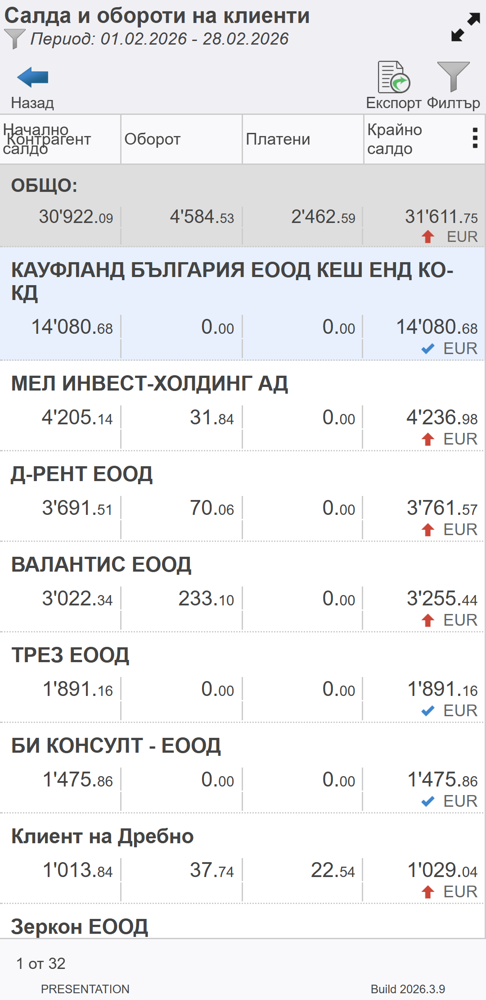
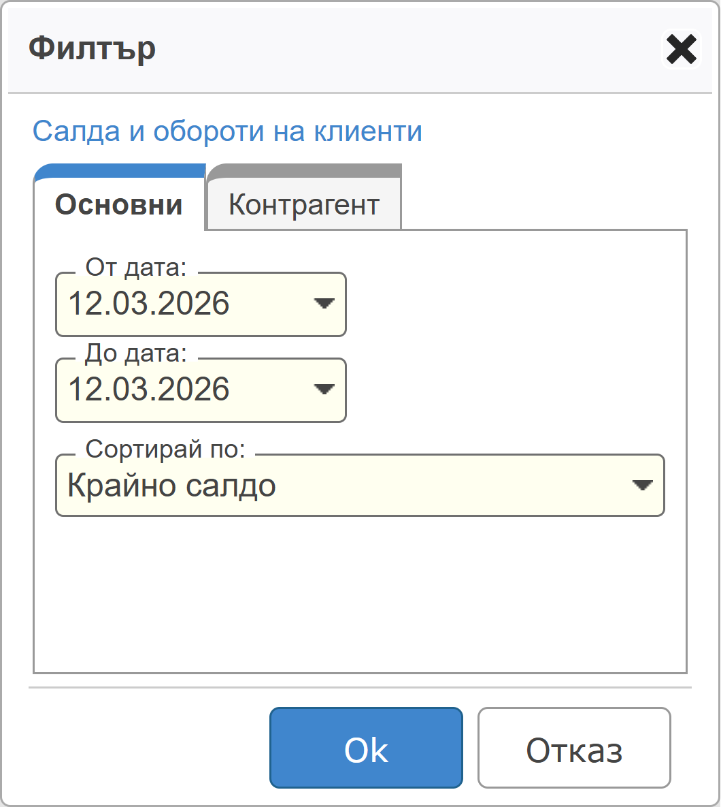

```{only} html
[Нагоре](../000-index)
```

# **Търговски справки**

Всички справки, които **Dreem Mobile** осигурява, са достъпни от основното меню.  
При всички справки от бутон [**Филтър**] се отваря форма за избор на критерии, по които да се филтрират данните.  

> Данните в справките варират спрямо приложените филтри.  
Показаните резултати се базират единствено на данни от документи, до които потребителят има достъп.     

Справките могат да бъдат записани във файл чрез бутон [**Експорт**].  
С бутон [**Напред**] се отваря форма с допълнителна информация за маркирания ред от справката.  

## **Продажби по продукти**

Справката показва информация с реализираните продажби по продукти за избран период от време.  

{ class=align-center w=7cm }

> При маркиране на ред и избор на бутон [**Напред**] се отваря форма с детайлна информация за продукта. Тя включва списък с контрагенти, какво количество от продукта е закупено и на каква стойност (с ДДС).  

Системата позволява филтриране на данните по продукти, дименсии, контрагенти и/или обекти.  

{ class=align-center w=7cm }

## **Задължения по клиенти**

Справката показва стойност на натрупаните задължения на клиенти към избрана дата.  

{ class=align-center w=7cm }

> При маркиране на ред и избор на бутон [**Напред**] се отваря форма с детайлна информация за контрагента. Тя включва списък с документи и задължения за периода.  
Показва следните:    
>  - *Документ* - Тип, номер, дата, падеж и просрочие на документа;    
>  - *Стйност с ДДС* - обща стойност с ДДС на документа;    
>  - *Платено* - сума на плащанията по документа;    
>  - *Задължение* - оставаща сума за плащане по документа;    

Системата позволява филтриране на данните по типове документи, контрагенти, дименсии и/или обекти.  

{ class=align-center w=7cm }

## **Обороти по клиенти**

Справката показва реализиран оборот по клиенти, обекти и търговец, както и обща стойност на продажбите за периода.  

{ class=align-center w=7cm }

> При маркиране на ред и избор на бутон [**Напред**] се отваря форма с детайлна информация за контрагента. Тя включва списък с документи, оборот и задължения за избрания период.  
Показва следните:    
>  - *Документ* - Тип, номер, дата, падеж и просрочие на документа;    
>  - *Стйност с ДДС* - обща стойност с ДДС на документа;    
>  - *Платено* - сума на плащанията по документа;    
>  - *Задължение* - оставаща сума за плащане по документа;    

Системата позволява филтриране на данните за период по типове документи, контрагенти, дименсии и/или обекти.  

{ class=align-center w=7cm }

## **Анализи**

Справката показва анализ на общте приходи от продажби.  
Данните се визуализират по месеци.  

{ class=align-center w=7cm }

Системата позволява филтриране на данните с или без ДДС по месеци.    

{ class=align-center w=7cm }
